# Aging-Aware NPU Core Remapping

> **NPU를 멈추지 않고, Conv 연산이 누적되는 물리 core를 바꾸어 compute exposure를 분산하는 연구**

이 저장소는 Tenstorrent **Eagle-N 5×4 worker grid**에서 실행되는 **BOS ResNet50 (batch 1)**을 대상으로, 고정된 Conv placement가 만드는 core별 사용량 편차를 줄이는 방법을 연구한 기록이다. 논리 tensor sharding은 유지하면서 물리 worker만 바꾸는 runtime mechanism, placement를 선택하는 MILP policy, 실제 보드의 correctness·latency 검증을 하나의 흐름으로 구현했다.

  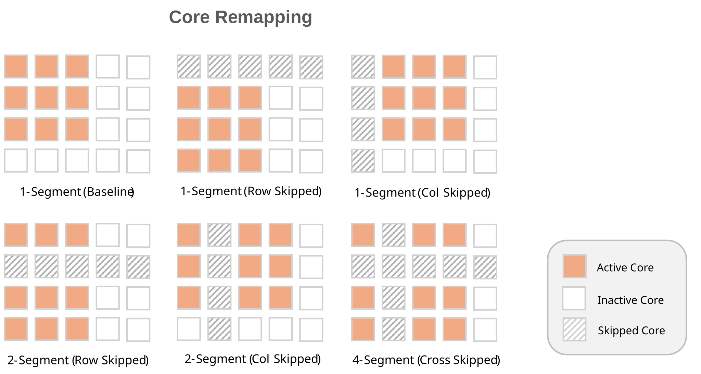

  <a href="presentation/NPU_challenge_Final_Report.pdf"><strong>최종 발표 보고서 PDF</strong></a> ·
  <a href="RESEARCH_LOG.md"><strong>연구 진행 기록</strong></a> ·
  <a href="data_movement/conv_core_replacement/policy/RESULTS.md"><strong>MILP 상세 결과</strong></a>

## Executive summary

NPU에서 동일한 연산이 항상 같은 물리 core에서 실행되면 특정 worker에 compute stress가 반복적으로 집중된다. 실제 BOS ResNet50 profile에서는 연산별 active-core 구성이 달랐고, 누적 core utilization에 **최대 7.92× 편차**가 관찰됐다. 이 연구는 다음 질문에서 출발했다.

> 모델의 계산 의미와 정확도를 유지하면서 Conv의 물리 실행 위치를 순환시켜, 추가 latency 없이 core별 compute exposure를 평준화할 수 있는가?

결론은 다음과 같다.

- `BLOCK_SHARDED`와 `HEIGHT_SHARDED` Conv의 지원 경로에서 논리 shard 순서를 보존한 물리 placement translation을 구현했다.
- 중간 row 또는 column이 비어 있는 placement를 여러 개의 합법적인 rectangular multicast로 분해해 실행했다.
- 다음 연산이 remapped tensor를 소비할 수 있으면 placement를 유지하고, 그렇지 않으면 안전하게 stock placement로 복귀하도록 planner를 구성했다.
- H=20 MILP 모델에서 predicted peak TRISC exposure를 **26.47% 감소**시켰다.
- 보드에서 검증한 remapping configuration의 full-model latency는 stock 대비 **−0.35%**로, 측정 범위에서 추가 overhead가 관찰되지 않았다.
- aging simulation에서는 가정한 stress model 아래 약 **1.5년**, stress time 기준 **1.35×**의 개선 가능성을 보였다. 이는 실측 수명 보증값이 아니라 상대 비교를 위한 모델 결과다.

| 핵심 지표 | Baseline | Remapped / optimized | 의미 |
|---|---:|---:|---|
| 누적 core utilization 편차 | — | 최대 7.92× 관찰 | 연구 동기 |
| Modeled max/mean worker load | 1.449874 | 1.065910 | H=20 policy 예측 |
| Modeled peak cycles / inference | 3,777,635.0 | 2,777,219.8 | **26.47% 감소** |
| Full-model device latency | 2.056535 ms | 2.049374 ms | **−0.35%, 추가 overhead 미관찰** |
| Full-model PCC | — | 0.999603608935384 | 검증 경로 correctness 유지 |
| Host regression | — | 36 / 36 passed | placement·safety·buffer·tensor spec |

## 1. 연구 배경: 고정 placement와 장기 신뢰성

Eagle-N은 NoC로 연결된 다수의 Tensix compute core에서 연산을 수행한다. 그러나 모델의 각 operator가 사용하는 grid 크기는 서로 다르고, 기본 placement는 대체로 좌측 상단에서 시작한다. 추론을 반복하면 자주 선택되는 core와 거의 쉬는 core가 고정되며, 장기적으로 불균일한 전기적·열적 stress가 누적될 수 있다.

  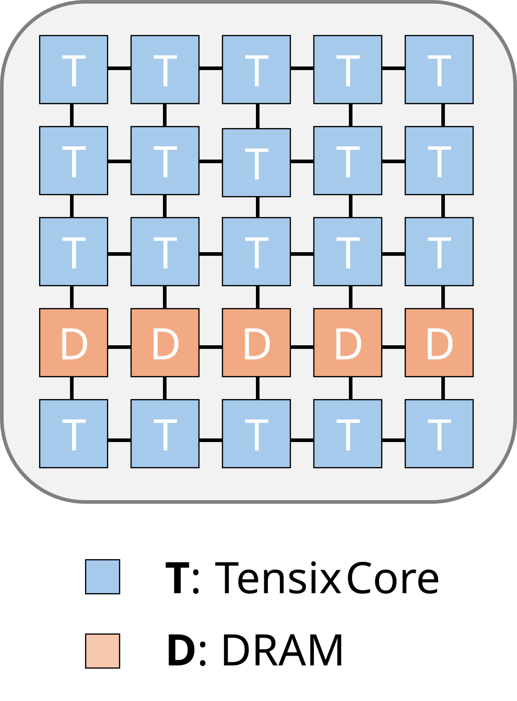

  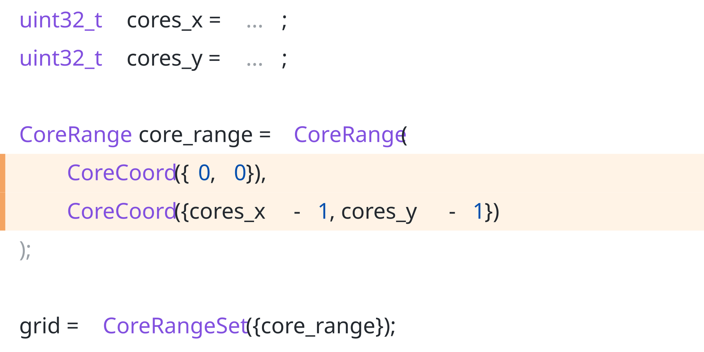

  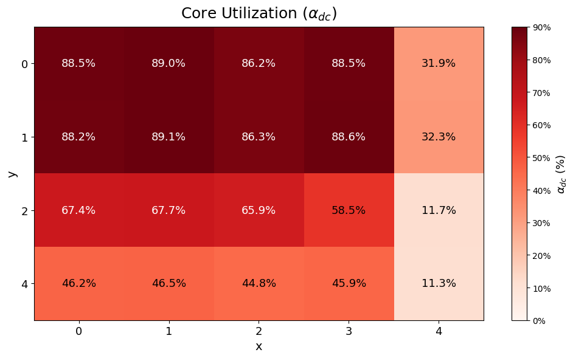

본 연구의 reliability 분석은 **BTI/NBTI에 따른 threshold-voltage 변화 → critical-path delay 증가 → timing violation probability 증가 → weight bit error → accuracy degradation**의 연결을 상대적으로 모델링한다. ResNet50 weight에 random bit error를 주입한 10,032회 실험으로 accuracy degradation curve를 적합하고, 가정한 delay-aging model과 결합했다.

이 분석은 remapping의 방향성을 평가하기 위한 **relative aging proxy**다. 실제 차량 환경의 절대 수명, 온도·전압 변화, SRAM/NoC aging, 공정 편차까지 예측하는 sign-off model은 아니다.

## 2. 왜 Conv remapping이 어려운가

Conv는 단순히 core 좌표만 바꾸면 되는 연산이 아니다. tensor는 `HEIGHT_SHARDED`, `BLOCK_SHARDED`, `WIDTH_SHARDED` 형태로 나뉘며, 각 shard는 activation·weight multicast와 halo exchange에 참여한다. 물리 grid에 gap이 생기면 기존의 단일 직사각형 multicast가 존재하지 않는 core를 destination으로 포함할 수 있어 잘못된 데이터 전달이나 device hang으로 이어질 수 있다.

  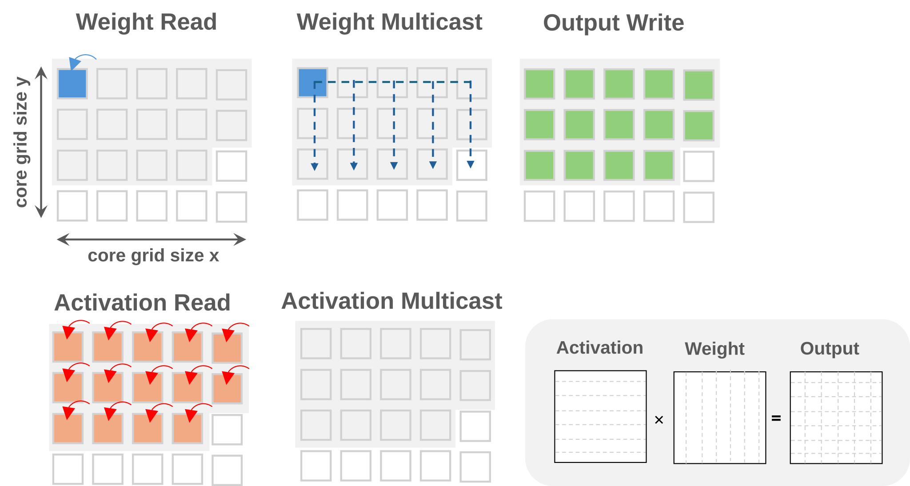
  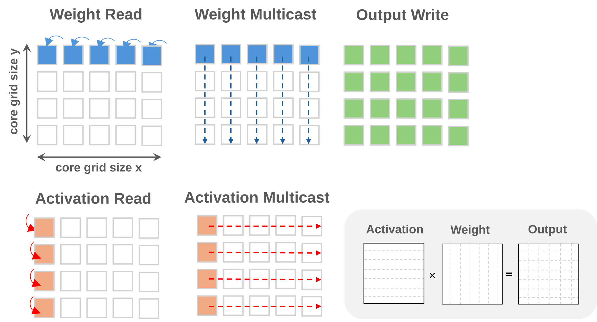

1D multicast는 한 축의 receiver 집합을, 2D multicast는 activation과 weight가 서로 다른 축으로 전파되는 구조를 사용한다. Remapping은 물리 위치를 바꾸면서도 기존 logical shard order와 sender/receiver 관계를 그대로 보존해야 한다.

  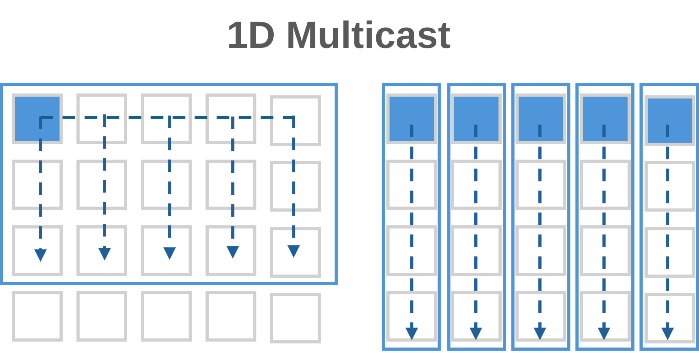
  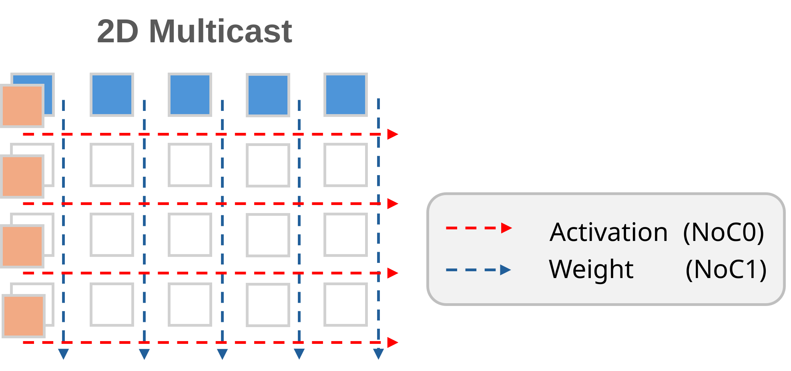

## 3. 제안 방식

### 3.1 Logical shard와 physical worker 분리

`CorePlacement`는 dense logical coordinate를 실제 worker coordinate로 변환한다. 예를 들어 논리적으로 연속된 네 개 column을 물리 column `{0, 1, 3, 4}`에 배치해도 tensor의 `ROW_MAJOR` shard 순서는 변하지 않는다. 이를 통해 operator의 계산 의미를 유지하면서 사용하지 않을 row와 column을 명시할 수 있다.

  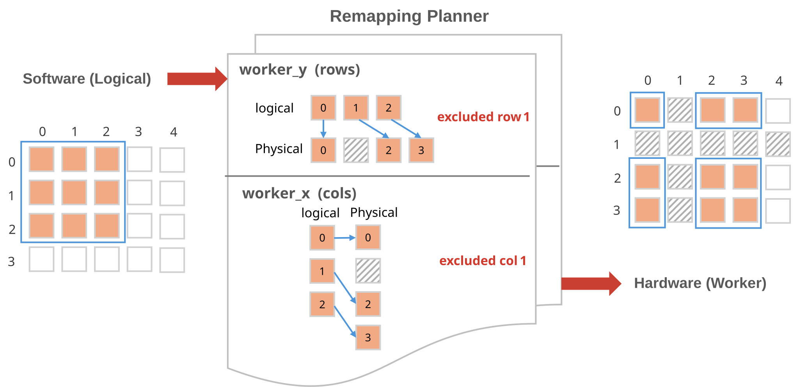

사용자는 Conv configuration에 제외할 worker row·column을 전달한다. 공개 API는 policy가 결정한 placement 요청만 표현하며, 실제 sharding과 multicast geometry는 host planner가 계산하고 검증한다.

  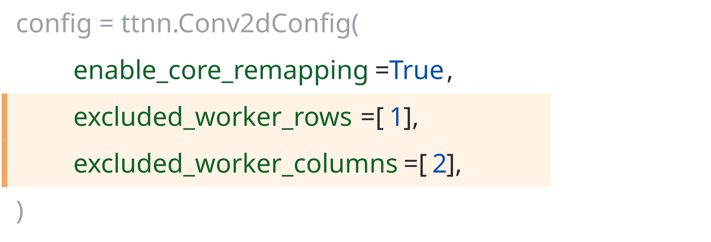

주요 구현:

- [`conv_core_placement.hpp`](operations/conv/conv2d/conv_core_placement.hpp): logical-to-physical mapping과 placement 표현
- [`conv_core_remapping_planner.hpp`](operations/conv/conv2d/conv_core_remapping_planner.hpp): 지원 여부, propagation, stock 복귀 결정
- [`conv2d.cpp`](operations/conv/conv2d/conv2d.cpp): Conv2D 경로 통합과 host-side validation

### 3.2 Segmented multicast

Gap이 있는 worker 집합은 NoC가 처리할 수 있는 **최대 연속 직사각형**들로 분해한다. 각 region은 자신의 data/semaphore multicast를 수행하고, write barrier는 전체 전송 완료를 기준으로 공유한다. Sender가 receiver region 안에 있는 경우에는 sender-local copy와 remote-only multicast를 분리한다.

  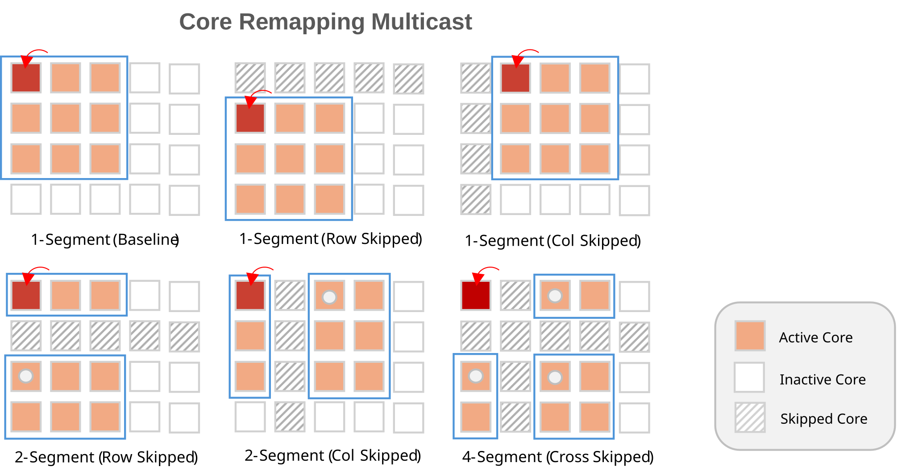

Microbenchmark에서 확인한 설계 기준은 다음과 같다.

- Sender 위치 자체의 영향은 작았다. 20개 core 사이에서 sender를 이동했을 때 median receiver wait 변화는 약 2%였다.
- Receiver 수가 9개에서 20개로 증가하면 completion time은 약 4.4–5.0% 증가했다.
- 끊어진 placement는 multicast 명령 수를 늘린다. 대표 실험에서는 추가 rectangle로 약 170 cycles가 증가했다.

따라서 policy는 단순한 부하 균등화뿐 아니라 **placement fragmentation 비용**도 함께 제한해야 한다.

### 3.3 Placement lifetime

Remapped output을 다음 operator가 동일한 logical order로 소비할 수 있으면 `Propagate`한다. 지원되지 않는 연산, residual join, layout 전환 또는 output topology 변경을 만나면 `ExitToStock`으로 복귀한다. 이 lifetime 관리는 Conv2→Conv3 chain, Matmul로 lowering되는 1×1 Conv, reshard와 downsample boundary를 함께 고려한다.

  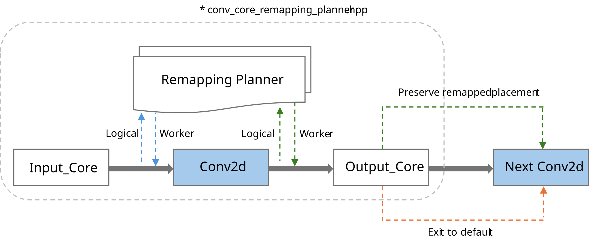

잘못된 multicast geometry는 host timeout 뒤에도 board가 복구되지 않는 hang을 만들 수 있다. 지원하지 않는 layout, 잘못된 shard order, 과도한 segmentation은 device enqueue 전에 host에서 거부한다. 보드 실험은 clean-device 확인과 외부 watchdog을 사용하는 guarded runner로만 수행한다.

## 4. Placement policy와 MILP

Runtime mechanism은 “어디에 놓을 수 있는가”를 제공하고, policy는 “각 inference에서 어디에 놓을 것인가”를 결정한다. Policy pipeline은 다음과 같다.

1. Stock BOS ResNet50에서 operator·worker별 TRISC cycles를 수집한다.
2. 각 Conv domain에 대해 실행 가능한 row/column exclusion candidate를 생성한다.
3. H=20 inference horizon에서 worker별 누적 exposure가 고르게 되도록 MILP를 푼다.
4. 선택된 phase별 placement를 manifest로 내보내 runtime validation에 전달한다.

MILP는 다음 목적을 우선순위대로 고정하며 반복 최적화한다.

1. 최대 누적 worker cycles 최소화
2. worker별 평균 절대편차 최소화
3. 추가 physical-axis segment 수 최소화
4. 사용하는 domain-placement program 수 최소화
5. phase 간 placement switch 수 최소화

### 레이어별 실행 특성을 고려한 단계적 최적화

레이어마다 sharding, grid shape, multicast 방식과 실행 비용이 다르다. 따라서 최종 발표에서는 **Layers 1–2를 우선 최적화·해석 범위로 제시**하고, 나머지 layer에는 각 실행 특성에 맞는 별도 해와 검증이 필요하다고 구분했다.

이후 offline H=20 모델은 Layers 1–4의 실행 가능한 Conv domain까지 candidate space를 확장했다. 다만 이 확대 결과는 stock logical-core cycles를 합법적인 물리 placement로 순열한 **예측 schedule**이며, 전체 candidate와 20개 phase의 보드 검증이 끝난 deployable policy는 아니다.

  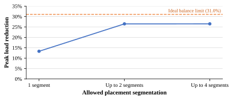

Segment-scope ablation에서는 두 영역까지 허용했을 때 peak reduction이 **13.3%에서 26.5%**로 증가했고, 이론적 ideal reduction의 약 **85.5%**를 확보했다. 네 영역까지 늘려도 유의미한 추가 이득은 없었다. 해당 two-region solve의 certified MILP gap은 **0.000989%**다.

최종 H=20 모델은 stock 대비 predicted peak cycles/inference를 3,777,635.0에서 2,777,219.8로 낮췄다. 총 TRISC work를 줄인 것이 아니라 동일한 modeled work를 20개 worker에 재분배한 결과다.

## 5. 보드 검증

Runtime mechanism은 host regression, isolated Conv, Conv chain, full-model의 순서로 검증했다.

| 검증 항목 | 결과 |
|---|---|
| Translated `BLOCK_SHARDED` Conv | isolated·chain·full-model 통과 |
| Segmented `BLOCK_SHARDED` Conv | column gap full-model, row/four-rectangle production chain 통과 |
| `HEIGHT_SHARDED` Conv | column/row gap, four rectangles, boundary translation 통과 |
| Placement propagation / stock 복귀 | Conv2→Conv3 및 downsample boundary 통과 |
| Full-model correctness | PCC 0.999603608935384 |
| Host regression | 36 / 36 passed |
| `WIDTH_SHARDED` exclusion | 미지원, host fail-fast |

### Latency: 적절한 policy는 추가 overhead 없이 적용 가능

  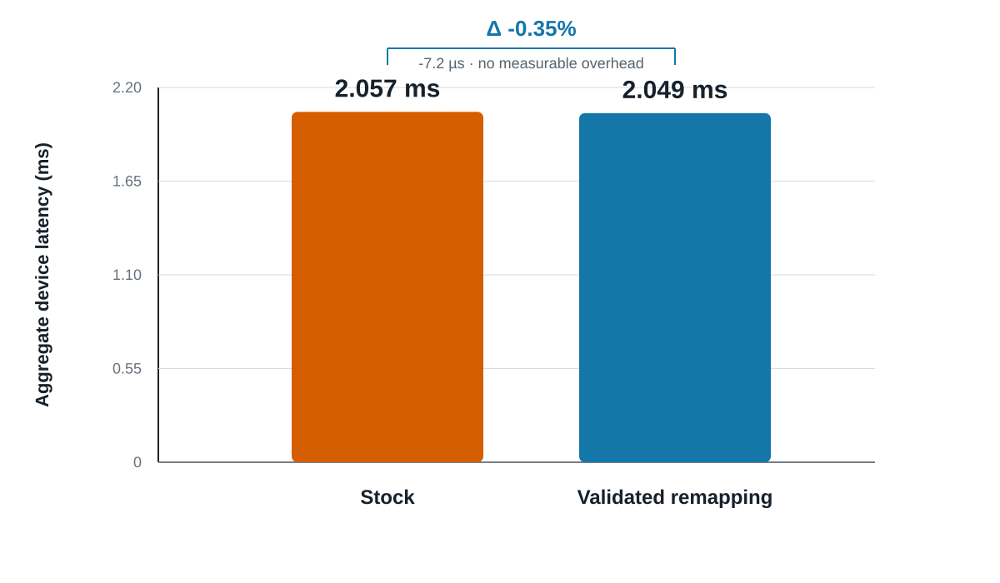

검증된 full-model remapping configuration의 aggregate device latency는 stock **2.056535 ms**, remapped **2.049374 ms**였다. 차이는 −7.2 µs, −0.35%다. 이 결과를 성능 향상으로 주장하지 않는다. 핵심은 **placement fragmentation과 lifetime을 제어하는 policy를 선택하면 compute exposure를 분산하면서도 측정 가능한 latency overhead 없이 실행할 수 있다**는 점이다.

이 latency 측정은 안전성이 먼저 검증된 **Layer3 cyclic column-rest phase 0** configuration을 사용했다. Layers 1–2 MILP schedule 전체의 latency 측정이나 H=20 전 phase의 board deployment 결과와는 구분한다.

## 6. Reliability simulation 결과와 해석 범위

가정한 NBTI delay model과 empirical accuracy model을 결합했을 때, remapping은 accuracy degradation 시점을 약 **1.5년 늦추고**, 동일 degradation threshold까지의 stress time을 약 **1.35×** 늘리는 결과를 보였다.

이 결과로 주장할 수 있는 것은 “compute exposure를 고르게 하면 가정한 aging model에서 degradation이 지연된다”는 상대적 경향이다. 다음 항목은 아직 포함하지 않는다.

- 실제 silicon lifetime 또는 AEC-Q100 수명 보증
- 온도·전압 telemetry와 공정별 aging parameter
- SRAM, NoC/NIU, memory controller 등 non-compute block의 aging
- Remapped placement별 실측 cycle variation을 반영한 전체 H=20 재최적화
- 모든 candidate와 phase에 대한 장시간 board validation

## 7. 연구 결과의 현재 경계

| 구분 | 완료 | 추가 작업 |
|---|---|---|
| Runtime mechanism | 지원 Conv slice의 placement·segmented multicast·lifetime 구현 | WIDTH sharding 및 더 넓은 operator 지원 |
| Policy | H=20 offline MILP와 segment ablation | layer별 measured cost를 반영한 독립 최적화 |
| Correctness | isolated, chain, 일부 full-model PCC 검증 | 모든 MILP candidate/phase 검증 |
| Performance | 검증된 configuration의 no-overhead latency 확인 | 반복 측정·분산·thermal condition 포함 |
| Reliability | relative aging simulation | silicon telemetry 기반 calibration |

따라서 **runtime mechanism의 가능성과 안전한 지원 범위**, **modeled exposure 개선**, **검증된 configuration의 correctness 및 latency**는 확인했다. 반면 H=20 MILP schedule 전체를 보드에서 실행해 실제 수명 개선을 입증한 단계는 아니다.

## 8. 저장소 안내

| 위치 | 내용 |
|---|---|
| [`presentation/`](presentation/README.md) | 최종 발표 PDF, 본문 SVG figure, 발표 대본 |
| [`study_note/`](study_note/README.md) | NPU architecture, profiling, reliability simulation 학습·실험 기록 |
| [`data_movement/one_to_all/`](data_movement/one_to_all/README.md) | sender 위치, receiver 수, segmented multicast microbenchmark |
| [`data_movement/conv_core_replacement/`](data_movement/conv_core_replacement/README.md) | Conv remapping test, guarded board runner, evidence |
| [`data_movement/conv_core_replacement/policy/`](data_movement/conv_core_replacement/policy/README.md) | calibration, candidate 생성, MILP, 결과 추출과 plot |
| [`operations/`](operations/) | Conv2D, Matmul, reshard, Halo runtime 변경 |
| [`ttnn/`](ttnn/) | 공개 Conv configuration과 binding 변경 |
| [`RESEARCH_LOG.md`](RESEARCH_LOG.md) | 연구 진행 과정과 주요 의사결정 |

### 구현 및 검증 진입점

- Core placement tests: [`test_core_placement.cpp`](data_movement/conv_core_replacement/test_core_placement.cpp)
- Conv integration tests: [`test_conv_core_replacement.cpp`](data_movement/conv_core_replacement/test_conv_core_replacement.cpp)
- BOS full-model tests: [`test_bos_resnet50_baseline.py`](data_movement/conv_core_replacement/test_bos_resnet50_baseline.py)
- Guarded full-model runner: [`run_bos_resnet50_full_model_guarded.sh`](data_movement/conv_core_replacement/run_bos_resnet50_full_model_guarded.sh)
- Validated latency runner: [`run_bos_resnet50_validated_latency_guarded.sh`](data_movement/conv_core_replacement/run_bos_resnet50_validated_latency_guarded.sh)
- Policy output validation: [`validate_policy_outputs.py`](data_movement/conv_core_replacement/policy/validate_policy_outputs.py)
- Detailed runtime design: [`CORE_REMAPPING_DESIGN.md`](data_movement/conv_core_replacement/docs/CORE_REMAPPING_DESIGN.md)
- MILP formulation: [`SCHEDULER_DESIGN.md`](data_movement/conv_core_replacement/policy/SCHEDULER_DESIGN.md)

장치 테스트에는 BOS SDK build, Eagle-N board, clean device state가 필요하다. Device hang 가능성이 있는 실험은 각 guarded runner의 safety gate와 watchdog 지침을 따라야 한다.

## 9. 연구 진행 요약

- **2026-07:** BOS/TT-Metal 구조 분석, ResNet50 profiling, TRISC exposure proxy 정립
- **2026-08 초:** sender 위치와 multicast geometry를 분리한 NoC microbenchmark 구축
- **2026-08 중:** `BLOCK_SHARDED`·`HEIGHT_SHARDED` Conv remapping, segmented multicast, placement lifetime 구현
- **2026-08 말:** H=20 MILP, segment ablation, guarded full-model PCC 및 latency 비교
- **2026-09:** 코드·실험 결과·발표 자료를 연구 archive 형태로 정리

상세한 시간순 기록은 [`RESEARCH_LOG.md`](RESEARCH_LOG.md), 구현 과정의 실패와 수정 근거는 [`CONV2D_CORE_REPLACEMENT_NOTES.md`](data_movement/conv_core_replacement/docs/CONV2D_CORE_REPLACEMENT_NOTES.md)에 정리했다.

## Repository policy

이 저장소는 현재 개인 연구 기록용 **private archive**를 전제로 한다. Raw profiler capture, build output, container backup, 중복 SDK checkout과 local virtual environment는 Git에서 제외한다. Source와 test의 기존 SPDX·attribution은 유지하며, 공개 포트폴리오로 전환하기 전에는 BOS SDK 및 사내 자료의 재배포 가능 범위를 별도로 검토해야 한다.
