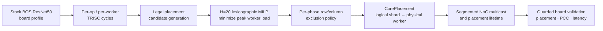

# NPU Core Remapping for Compute-Exposure Balancing

이 저장소는 NPU의 논리 연산을 항상 같은 물리 worker core에서 실행하는 대신,
동일한 tensor sharding 의미를 유지하면서 실행 위치를 바꾸어 장기적인 compute
exposure를 분산할 수 있는지 연구한 기록이다.

대상 시스템은 **Eagle-N 5×4 worker grid**에서 실행되는 **BOS ResNet50,
batch 1**이다. 연구 범위는 단순한 스케줄 시뮬레이션에 그치지 않고 다음 세
부분을 함께 다룬다.

1. 실제 Conv2D 실행 위치를 변경하는 runtime mechanism
2. 측정된 TRISC cycles를 바탕으로 placement를 선택하는 offline MILP policy
3. placement, PCC, device shutdown, latency를 확인하는 guarded board validation

## 한눈에 보는 연구 질문과 결론

고정된 core placement는 특정 worker에 연산을 반복적으로 집중시킨다. 이 연구의
질문은 다음과 같다.

> 논리 shard 순서와 모델 정확도를 유지하면서 Conv의 물리 실행 core를 순환시켜,
> latency overhead 없이 worker별 compute exposure를 평준화할 수 있는가?

현재 결론은 다음과 같다.

- 지원하는 `BLOCK_SHARDED` 및 `HEIGHT_SHARDED` Conv 경로에서는 논리 shard와
  물리 worker를 분리한 명시적 placement translation이 동작한다.
- 물리적으로 끊긴 worker 집합도 합법적인 직사각형 NoC multicast 명령으로
  분해하여 실행할 수 있다.
- 검증된 remapping configuration은 full-model PCC를 유지했고, 측정 latency는
  stock과 사실상 동일했다.
- H=20 MILP 모델에서는 peak modeled TRISC exposure가 26.47% 감소했다.
- 다만 이 수치는 **측정된 stock cycles를 재배치한 예측값**이다. H=20 전체
  schedule의 모든 candidate를 보드에서 실행한 결과나 물리적인 aging lifetime
  예측값으로 해석하면 안 된다.

## 전체 연구 흐름

측정값은 policy의 비용 모델을 만들고, MILP는 합법적인 candidate 중 장기 누적
부하를 가장 고르게 만드는 조합을 찾는다. Runtime은 선택된 placement를 실제
Conv, Halo, Matmul, reshard 경로에 전달한다. 마지막으로 보드 검증은 solver가
알 수 없는 deadlock, correctness, placement lifetime, latency 문제를 걸러낸다.

## 핵심 설계

### 1. Logical shard와 physical worker의 분리

`CorePlacement`는 dense logical shard coordinate를 실제 worker coordinate로
변환한다. 따라서 물리 grid가 이동하거나 중간 row/column이 비어 있어도 tensor의
논리적 `ROW_MAJOR` shard 순서는 유지된다.

주요 구현은
[`conv_core_placement.hpp`](operations/conv/conv2d/conv_core_placement.hpp)와
[`conv_core_remapping_planner.hpp`](operations/conv/conv2d/conv_core_remapping_planner.hpp)에
있다.

### 2. Segmented multicast

기존 Conv kernel은 하나의 연속된 직사각형 core grid를 전제로 한다. Remapping
후 receiver가 여러 영역으로 나뉘면 activation 또는 weight multicast가 gap을
가로지를 수 있다.

구현에서는 선택된 worker 축을 연속 segment로 나누고, 그 Cartesian product를
NoC가 처리할 수 있는 최대 직사각형들로 만든다. Sender-local copy와 remote-only
multicast를 분리하고, 각 segment의 destination count와 sender 포함 여부를
host에서 검증한다.

### 3. Placement lifetime

한 Conv의 출력 placement를 다음 연산이 그대로 소비할 수 있으면 `Propagate`하고,
지원하지 않는 연산이나 residual boundary를 만나면 `ExitToStock`으로 원래
placement에 복귀한다. 이 결정은 Conv2D뿐 아니라 다음 Matmul-lowered 1×1 Conv와
reshard 경로까지 함께 고려한다.

### 4. Host preflight와 guarded execution

잘못된 multicast geometry는 host process timeout만으로 device를 복구할 수 없는
hang을 만들 수 있다. 따라서 지원하지 않는 layout, 과도하게 분할된 placement,
잘못된 shard order는 device enqueue 전에 거부한다. 보드 테스트는 clean-device
확인과 외부 watchdog을 요구하며, 실패 시 다음 workload를 자동으로 진행하지
않는다.

### 5. Offline MILP policy

MILP는 20개 inference phase에 걸쳐 각 placement domain의 candidate 사용 횟수를
결정한다. 목적함수는 다음 순서의 lexicographic optimization이다.

1. 최대 누적 worker cycles 최소화
2. worker별 평균 절대편차 최소화
3. 추가 physical-axis segment 수 최소화
4. 사용하는 domain-placement program 수 최소화
5. phase 간 placement switch 수 최소화

Policy 생성과 결과 해석은
[`policy/`](data_movement/conv_core_replacement/policy/README.md)에 정리되어 있다.

## 주요 결과

| 구분 | Stock | Remapped / optimized | 해석 |
|---|---:|---:|---|
| Modeled max/mean worker load | 1.449874 | 1.065910 | H=20 MILP 예측 |
| Modeled peak cycles / inference | 3,777,635.0 | 2,777,219.8 | peak exposure 26.47% 감소 |
| Full-model aggregate device latency | 2.056535 ms | 2.049374 ms | 검증된 Layer3 cyclic phase 0, -0.35% |
| Full-model PCC | — | 0.999603608935384 | 검증된 remapping 경로 통과 |
| Host regression | — | 36/36 passed | placement 19, safety 9, buffer 4, tensor spec 4 |

Latency 차이는 성능 향상으로 주장하지 않는다. 측정 변동 범위에서 **지원되는
placement policy를 선택하면 remapping을 사실상 추가 latency 없이 적용할 수
있다**는 근거로 사용한다.

Segment scope ablation에서는 두 개 영역까지 허용했을 때 가능한 peak reduction의
85.35%를 확보했으며, 해당 two-region solve의 certified MILP gap은 0.000989%였다.
최종 H=20 multi-stage schedule의 certificate와 제한 조건은
[`RESULTS.md`](data_movement/conv_core_replacement/policy/RESULTS.md)에 별도로 기록한다.

## 검증 범위와 주장 경계

| 항목 | 현재 상태 |
|---|---|
| Contiguous translated `BLOCK_SHARDED` Conv | isolated, chain, full-model 검증 |
| Segmented `BLOCK_SHARDED` Conv | column gap full-model, row/four-rectangle production chain 검증 |
| `HEIGHT_SHARDED` Conv | column gap, row gap, four rectangles, boundary translation 검증 |
| Placement propagation / `ExitToStock` | Conv2→Conv3 및 downsample boundary 검증 |
| `WIDTH_SHARDED` exclusion | 미지원, host fail-fast |
| Complete H=20 MILP deployment | candidate별 보드 검증 전이므로 미완료 |
| Aging model | TRISC compute exposure proxy만 포함; thermal, voltage, SRAM, NoC/NIU, process variation 제외 |

즉, runtime mechanism의 지원 slice와 일부 full-model 경로는 보드에서 검증됐지만,
MILP가 생성한 20-phase 전체 조합을 모두 실측했다고 주장하지 않는다.

## 저장소 구성

| 영역 | 역할 | 위치 |
|---|---|---|
| 연구 개요와 시간순 기록 | 연구 방향, 전환점, 결과 요약 | 이 문서와 [`RESEARCH_LOG.md`](RESEARCH_LOG.md) |
| Architecture / aging study | 장치 구조, profiling, stress model, 초기 simulation | [`study_note/`](study_note/README.md) |
| NoC microbenchmark | NoC0/NoC1, sender 위치, rectangle shape, segmented transfer | [`data_movement/one_to_all/`](data_movement/one_to_all/README.md) |
| Conv remapping tests | host unit test, BOS integration test, guarded runner | [`data_movement/conv_core_replacement/`](data_movement/conv_core_replacement/README.md) |
| MILP policy | calibration, candidate generation, optimizer, 결과 및 figure | [`data_movement/conv_core_replacement/policy/`](data_movement/conv_core_replacement/policy/README.md) |
| SDK integration | Conv, Matmul, reshard, Halo, TensorSpec 변경 | [`operations/`](operations/)와 [`ttnn/`](ttnn/) |
| 발표 자료 | 편집 가능한 diagram, equation, 발표 대본 | [`presentation/`](presentation/README.md) |

SDK build와 Python import가 실제 경로에 의존하므로 production-facing source는 원래
디렉터리를 유지했다. 설명 문서, 발표 자료, 검증 evidence만 목적별 폴더로 분리했다.

## 재현 및 검증 진입점

- Host 및 placement tests:
  [`test_conv_core_replacement.cpp`](data_movement/conv_core_replacement/test_conv_core_replacement.cpp),
  [`test_core_placement.cpp`](data_movement/conv_core_replacement/test_core_placement.cpp)
- BOS full-model tests:
  [`test_bos_resnet50_baseline.py`](data_movement/conv_core_replacement/test_bos_resnet50_baseline.py)
- Guarded full-model runner:
  [`run_bos_resnet50_full_model_guarded.sh`](data_movement/conv_core_replacement/run_bos_resnet50_full_model_guarded.sh)
- Validated latency runner:
  [`run_bos_resnet50_validated_latency_guarded.sh`](data_movement/conv_core_replacement/run_bos_resnet50_validated_latency_guarded.sh)
- Policy validation:
  [`validate_policy_outputs.py`](data_movement/conv_core_replacement/policy/validate_policy_outputs.py)
- Board evidence:
  [`evidence/`](data_movement/conv_core_replacement/evidence/README.md)

장치 테스트는 일반 로컬 환경에서 실행할 수 있는 단위 테스트가 아니다. 지원되는
BOS SDK build, Eagle-N board, clean device state가 필요하며 각 runner의 safety
gate를 따라야 한다.

## 연구 진행 과정

- **2026-07:** BOS/TT-Metal 구조 분석, ResNet50 profiling, TRISC exposure proxy 정립
- **2026-08 초:** sender 위치와 multicast geometry를 분리한 NoC microbenchmark 구축
- **2026-08 중:** `BLOCK_SHARDED` 및 `HEIGHT_SHARDED` Conv remapping, segmented multicast,
  placement lifetime 구현
- **2026-08 말:** H=20 MILP policy, segment ablation, guarded full-model PCC 및 latency 비교
- **2026-09:** 코드·결과·발표 자료를 비공개 연구 archive 구조로 정리

상세한 날짜별 기록은 [`RESEARCH_LOG.md`](RESEARCH_LOG.md), 구현 중 발견한 실패와
수정 근거는
[`CONV2D_CORE_REPLACEMENT_NOTES.md`](data_movement/conv_core_replacement/docs/CONV2D_CORE_REPLACEMENT_NOTES.md)에
남겨 두었다.

## 권장 읽기 순서

1. 이 문서 — 문제, 설계, 결과, 주장 범위
2. [`CORE_REMAPPING_DESIGN.md`](data_movement/conv_core_replacement/docs/CORE_REMAPPING_DESIGN.md) — runtime mechanism 상세
3. [`SCHEDULER_DESIGN.md`](data_movement/conv_core_replacement/policy/SCHEDULER_DESIGN.md) — MILP formulation
4. [`RESULTS.md`](data_movement/conv_core_replacement/policy/RESULTS.md) — 수치와 solver certificate
5. [`RESEARCH_LOG.md`](RESEARCH_LOG.md) — 시간순 연구 활동

## Repository policy

이 저장소는 현재 개인 연구 기록을 위한 **private archive**로 유지한다. Raw profiler
capture, container backup, build output, 중복 SDK checkout, local virtual environment는
로컬에 보관하되 Git에서는 제외한다. Source와 test의 기존 SPDX 및 attribution은
유지한다. 공개 포트폴리오로 전환하기 전에는 BOS SDK와 사내 자료의 재배포 가능
범위를 별도로 검토해야 한다.
