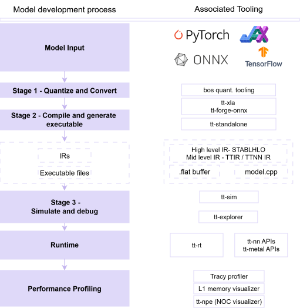

# AI Model SDK

This section introduces the BOS AI Models SDK and its end-to-end development workflow, illustrated in the accompanying diagram. It outlines how models develop by moving from high-level frameworks through a transparent, hardware-aware compilation pipeline into efficient execution on BOS NPUs. The development workflow is supported by a rich set of tools for validation, optimization, and performance analysis. Together, these components provide developers with full visibility and control, enabling efficient deployment, fine-grained tuning, and deep insight into both model behavior and hardware execution.

## AI Model Development Workflow

## AI Model Compiler

BOS delivers a modern, end-to-end AI model compiler built on top of Tenstorrent’s software stack, designed to seamlessly bridge framework-level models and efficient NPU execution. It is a transparent, debuggable, and hardware-aware AI compiler stack that gives developers full visibility and control, from model ingestion to final execution, while remaining flexible across frameworks and deployment targets.

BOS proposes a 3-stage compilation workflow, detailed in the next sections.

## Debugging

While the BOS SDK emphasizes pre-compilation preparation, ttnn-standalone enables debugging and validation after compilation.

ttnn-standalone is a runtime-level tool that allows developers to execute compiled TTNN models independently of the full runtime stack. It is primarily used to:

- Run compiled models and validate correctness against reference outputs
- Inspect execution behavior and experiment with runtime configurations
- Perform post-compilation tuning and debugging of model execution
- Isolate issues between compilation and hardware/runtime execution

This makes it particularly useful for identifying discrepancies that only appear after lowering and compilation, complementing IR-level debugging tools such as TT-Explorer.

## Runtime

### TT-NN runtime

- Build and run AI models using a PyTorch-like API
- Execute neural network operations without managing low-level hardware details

### TT-Metalium runtime

- Develop custom kernels and integrate them into model execution
- Control data movement, memory layout, and execution scheduling
- Optimize performance by tuning parallelism, tiling, and compute patterns

### TT-LLK (Low-Level Kernels)

With TT-LLK, users can:

- Access bare-metal compute primitives on Tensix cores
- Implement custom operations using:
- data unpacking
- compute (math kernels)
- data packing
 
- Write highly optimized kernels with fine-grained hardware control
- Maximize performance by directly managing compute and data flow
- Extend or customize the foundation of the runtime and compiler stack
- Develop and validate kernels for different Tenstorrent architectures

## Performance Profilers

### Tracy profiler

With **Tracy**, users can:

- Profile host-side execution (C++ and Python in TT-Metal runtime)
- Visualize timeline of model execution and system activity
- Identify performance bottlenecks and hotspots
- Measure latency and throughput of model operations
- Analyze kernel execution behavior across Tensix cores
- Inspect data movement and scheduling interactions
- Correlate CPU-side activity with accelerator execution
- Optimize end-to-end performance across host + device

### Memory visualizer

With **ttnn-visualizer**, users can:

- Inspect SRAM, DRAM, and circular buffer usage over time
- Identify peak memory consumption and bottlenecks
- Analyze tensor allocation and buffer usage per operation
- Understand how tensors are sharded and distributed across cores
- Visualize data movement and operation sequencing
- Explore per-tensor details interactively
- Optimize memory layout and buffer reuse strategies
- Improve overall memory efficiency and model performance

### NOC visualizer

With **tt-npe**, users can:

- Analyze network-on-chip (NoC) traffic patterns
- Track data movement between cores and memory
- Identify bandwidth bottlenecks and congestion points
- Understand inter-core communication behavior
- Optimize data routing and communication efficiency
- Correlate NoC activity with model execution phases
- Improve performance of distributed compute and data movement

## 이미지

  <!-- https://developers.bos-semi.com/img/bos_ai_models_workflow_v6.svg -->
  <!-- https://developers.bos-semi.com/img/BOS_Logo_4E_RGB.avif -->
