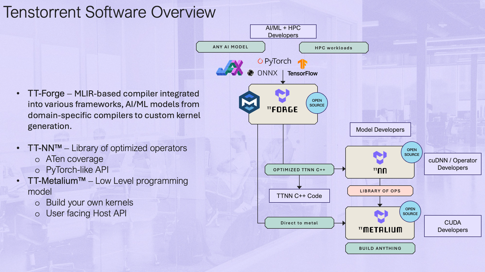

# Executable Artifact Generation

This section covers the compiler stack used to turn AI models into executable workloads on BOS hardware.

- [Stage 1 Convert and Quantize](#stage-1-convert-and-quantize).
- [Stage 2 Compile and Generate executable artifacts](#stage-2-compile-and-generate-executable-artifacts).
- [Stage 3 Visualize, Simulate and Debug](#stage-3-visualize-simulate-and-debug).

## Stage 1 Convert and Quantize[](#stage-1-convert-and-quantize)

TT-Forge is a framework-agnostic graph compiler frontend coming from the Tenstorrent software stack, designed to ingest, optimize, and transform AI models into hardware-executable representations for BOS NPU AI accelerators.

- Input: User Models (Pytorch/TF/ONNX)
- Output: stableHLO High level Intermediate Representation and TTIR Mid level Intermediate Representation

TTIR code example:

```
// TTIR: Named ops on tensors (akin to shlo, tosa, etc)
//
// This should be the default IR that users who need a higher-level abstraction
// over tensors.
//
// Example IR:
func.func @simple_linear(
%arg0: tensor<64x128xbf16>,
%arg1: tensor<128x64xbf16>,
%bias: tensor<64x64xbf16>) -> tensor<64x64xbf16> {
%0 = ttir.empty() : tensor<64x64xbf16>
%1 = "ttir.linear"(%arg0, %arg1, %bias, %0) : (tensor<64x128xbf16>, tensor<128x64xbf16>, tensor<64x64xbf16>, tensor<64x64xbf16>) -> tensor<64x64xbf16>
return %1 : tensor<64x64xbf16>
}
```
The following features are under development and will be part of next SDK versions

| Category | Subcategory | Items | 
|---|---|---|
| Quantization | INT8-LLM/VLM | INT8 quantization implementation on Eagle-N A0INT8 vs MXINT4 vs MXINT2 SW benchmarkQuantization accuracy benchmark with NvidiaLlama and Qwen VL implementation on Eagle-N B0
 | 
| Quantization | INT8-Vision | INT8 SW benchmarkYOLO
 | 
| Quantization | General | MXINT4 Accuracy analysisINT8 Quantization OptimizationQuantization Kernel Implementation
 | 

TT-Forge is Tenstorrent's MLIR-based compiler. It integrates into various compiler technologies from AI/ML frameworks, to both enable running models and create custom kernels.

### Quick Links[](#quick-links)

- [Getting Started / How to Run a Model](https://docs.tenstorrent.com/tt-forge/getting_started.html)
- [Interactive Tenstorrent Software Diagram](#interactive-tenstorrent-software-architecture-diagram)
- [TT-XLA](https://github.com/tenstorrent/tt-xla)- (single and multi-chip) For use with PyTorch and JAX.
- [TT-Forge-ONNX](https://github.com/tenstorrent/tt-forge-onnx)- (single chip only) For use with ONNX and PaddlePaddle. It also runs PyTorch; however, TT-XLA is recommended for PyTorch.
- [TT-MLIR](https://github.com/tenstorrent/tt-mlir)- Open source compiler framework for compiling and optimizing machine learning models for Tenstorrent hardware
- [TT-Metal](https://github.com/tenstorrent/tt-metal)- Low-level programming model, enabling kernel development for Tenstorrent hardware
- [TT-TVM](https://github.com/tenstorrent/tt-tvm)- A compiler stack for deep learning systems designed to close the gap between the productivity-focused deep learning frameworks, and the performance and efficiency-focused hardware backends

### What Is This Repo?[](#what-is-this-repo)

This repository is the central hub for the TT-Forge compiler project, bringing together its various sub-projects into a cohesive product. Here, you'll find releases, demos, model support, roadmaps, and other key resources as the project evolves. Please file any issues with questions or feedback you may have [here](https://github.com/tenstorrent/tt-forge/issues).

### Getting Started Guide[](#getting-started-guide)

To start with compilation, check the documentation in the [Front End](#current-ai-framework-front-end-projects) section. You can also run a demo  by following the [TT-Forge Getting Started](https://docs.tenstorrent.com/tt-forge/) page.

### Project Goals[](#project-goals)

- Provide abstraction of many different frontend frameworks
- Generically compile many kinds of model architectures without modification and with good performance
- Abstract all Tenstorrent device architectures

### Project Overview[](#project-overview)

TT-Forge brings together multiple components, including front ends for widely used third-party AI frameworks, the MLIR compiler stack, performance optimizations, and supporting tools. It then lowers workloads to the TT-Metalium layer, extending the capabilities of our AI software ecosystem.

### Interactive Tenstorrent Software Architecture Diagram[](#interactive-tenstorrent-software-architecture-diagram)

Overview of Tenstorrent's Open Source AI software ecosystem. Click on components to navigate to their repositories:

### FAQ[](#faq)

- **Can the user set dtype? How?**- Datatypes are generally inferred by the front end framework. However, certain front ends provide options to override the default datatype selection. See next bullet for an example.
- Enable bfp8 conversion using compile options. The model **MUST**be cast to bfloat16 before compilation.
 

```
torch_xla.set_custom_compile_options({
    "enable_bfp8_conversion": "true",  # Enable bfloat8_b for the whole model
    "experimental_enable_weight_bfp8_conversion": "true",  # Enable bfloat8_b for just model weights
})
```
- **How to set shard configs?**- In tt-xla, sharding can be configured using the `xs.mark_sharding`function from the`torch_xla`module. Here's an example of how to set shard configurations ([See example model](https://github.com/tenstorrent/tt-xla/tree/main/tests/torch/models/llama3/test_llama_step_n300.py)):
 
- In tt-xla, sharding can be configured using the 

```
import torch_xla.distributed.spmd as xs
import torch_xla.core.xla_model as xm
import torch_xla.runtime as xr
from infra.utilities.torch_multichip_utils import enable_spmd, get_mesh
xr.set_device_type("TT")
enable_spmd()
device: torch.device = xm.xla_device()
mesh: Mesh = get_mesh((1, xr.global_runtime_device_count()), ("batch", "model"))
xs.mark_sharding(my_input_tensor, mesh, ("model", None))
```
- 
**Is there a way to visualize the graph?**- Yes, you can use `tt-explorer`to visualize and analyze the compiled graphs. It provides a user-friendly interface to inspect the model structure, operations, and performance metrics.
- See the [TT-MLIR Explorer docs pages](https://docs.tenstorrent.com/tt-mlir/tt-explorer/tt-explorer.html)for more information.
 
- Yes, you can use 
- 
**User responsibilities**- Users are responsible for ensuring that their models are compatible with the Tenstorrent hardware and software stack. This includes adhering to supported data types, model architectures, and sharding configurations.
- If a user configures their model incorrectly (e.g., using unsupported data types or sharding strategies), they may encounter compilation errors, runtime errors, incorrect results, or suboptimal performance. It is recommended to refer to the documentation and examples provided for guidance on best practices.
 
- 
**Will TT-Forge-ONNX be deprecated?**- No, TT-Forge-ONNX will not be deprecated. It will continue to be supported for single-chip configurations and for frameworks such as ONNX, PaddlePaddle, and TensorFlow. However, for PyTorch and Jax models, it is recommended to use TT-XLA, especially for multi-chip configurations.
 

### Current AI Framework Front End Projects[](#current-ai-framework-front-end-projects)

- 
- TT-XLA is the primary frontend for running PyTorch and JAX models. It leverages a PJRT interface to integrate JAX (and in the future other frameworks), TT-MLIR, and Tenstorrent hardware. It supports ingestion of JAX models via jit compile, providing StableHLO (SHLO) graph to TT-MLIR compiler. TT-XLA can be used for single and multi-chip projects.
- See the [TT-XLA docs pages](https://docs.tenstorrent.com/tt-xla)for an overview and getting started guide.
 
- 
- A TVM-based graph compiler designed to optimize and transform computational graphs for deep learning models. It supports ingestion of ONNX, TensorFlow, PaddlePaddle, and similar ML frameworks via TVM ([TT-TVM](https://github.com/tenstorrent/tt-tvm)). It also supports ingestion of PyTorch; however, TT-XLA is recommended. TT-Forge-ONNX does not support multi-chip configurations and is intended for single-chip projects only.
- See the [TT-Forge-ONNX docs pages](https://github.com/tenstorrent/tt-forge-onnx)for an overview and getting started guide.
 
- A TVM-based graph compiler designed to optimize and transform computational graphs for deep learning models. It supports ingestion of ONNX, TensorFlow, PaddlePaddle, and similar ML frameworks via TVM (

[TT-MLIR](https://github.com/tenstorrent/tt-mlir) Project[](#tt-mlir-project)

At its core TT-MLIR is our compiler interfacing with TT-Metal our open-source low level AI Hardware SDK. TT-MLIR provides a solution for optimizing machine learning and other compute workloads for all tenstorrent hardware. TT-MLIR bridges the gap between all different ML Frameworks and Tenstorrent Hardware. TT-MLIR is broken into different dialects:

- 
TTIR Dialect: Our common IR that can then be lowered into multiple backends 
- 
TTNN Dialect: Our entry point into the TTNN Library of Ops 
- 
TTMetalium Dialect: Our entry point into directly accessing tt-metalium kernels 

The compiler employs various optimization passes, including layout transformation, operation fusing, decomposition, and sharding, ensuring the efficient lowering to the target dialect.

#### TT-MLIR Tools and Capabilities[](#tt-mlir-tools-and-capabilities)

- 
TTMLIR-Opt: This tool is used to run the TT-MLIR compiler passes on **.mlir**source files and is central to developing and testing the compiler.
- 
TTMLIR-Translate: TTMLIR-Translate allows us to ingest something (e.g., code) into the MLIR compiler, and produces outputs (such as an executable binary or code) from MLIR compiler. 
- 
TTRT: It is a standalone runtime tool that can inspect and run compiler executable files without front-end. 
- 
TT-Explorer: It provides a “Human-In-Loop” interface such that the compiler results can be actively tuned and understood by the person compiling the model. 
- 
TTNN-Standalone: This is a post-compile tuning/debugging tool for C++ TTNN generated code. 

## Stage 2 Compile and Generate executable artifacts[](#stage-2-compile-and-generate-executable-artifacts)

Stage 2 of the compiler pipeline focuses on visualization, simulation, and debugging of compiled models. Use TT-Explorer for graph inspection, TTSim for hardware simulation, and debugging tools to validate model behavior before deploying to physical Eagle-N hardware.

### tt-mlir[](#tt-mlir)

Graph lowering & optimization

- Convert high-level model representations (e.g., StableHLO) into Tenstorrent IRs (TTIR → TTNN)
- Apply compiler optimization passes (fusion, constant folding, layout transformations)
- Inspect and manipulate intermediate IR at multiple abstraction levels
- Control and experiment with compilation passes using `ttmlir-opt`
- Debug compilation issues by analyzing IR transformations step-by-step
- Prepare the model for hardware-aware mapping while keeping flexibility in transformations

### ttnn[](#ttnn)

Hardware-specific compilation (TTNN)

- Map the model into a hardware-aligned representation ready for execution
- Define tensor layouts, tiling, and sharding across Tensix cores
- Control memory placement (L1, DRAM) and data movement strategies
- Select and configure operations aligned with the TTNN execution model
- Optimize compute vs memory trade-offs for performance
- Get a near-final view of how the model will run on the NPU

tt-mlir is a compiler project aimed at defining MLIR dialects to abstract compute on Tenstorrent AI accelerators.
It is built on top of the [MLIR](https://mlir.llvm.org/) compiler infrastructure and targets [TTNN](https://github.com/tenstorrent/tt-metal).

For more information on the project, see [https://tenstorrent.github.io/tt-mlir/](https://tenstorrent.github.io/tt-mlir/).

### Quick Links[](#quick-links-1)

### What is this Repo?[](#what-is-this-repo-1)

tt-mlir is an open-source compiler framework that is used to compile and optimize machine learning models for Tenstorrent's custom AI hardware, such as Wormhole and Blackhole. Built on top of LLVM’s MLIR, it defines custom dialects and transformation passes tailored for Tenstorrent's architectures. It enables efficient translation of models from front-end dialects, such as StableHLO, into binaries optimized for Tenstorrent accelerators.

### Project Goals[](#project-goals-1)

- **Generality**: Support a wide range of AI models and workloads including training
- **Scalable**: First class primitives to describe scaling to multichip systems
- **Performant**: Enable great out of the box performance
- **Tooling**: Enable human in the loop guided compiler optimization
- **Open Source**: All project development is done in the open

### Related Tenstorrent Projects[](#related-tenstorrent-projects)

## Stage 3 Visualize, Simulate and Debug[](#stage-3-visualize-simulate-and-debug)

Stage 3 of the compiler pipeline focuses on visualization, simulation, and debugging of compiled models. Use TT-Explorer for graph inspection, TTSim for hardware simulation, and debugging tools to validate model behavior before deploying to physical Eagle-N hardware.

### Visualize your graph with TT-Explorer.[](#visualize-your-graph-with-tt-explorer)

TT-Explorer is an interactive visualization and debugging tool in the TT-MLIR stack that lets developers inspect, analyze, and experiment with compiled MLIR models (e.g., StableHLO, TTIR, TTNN) through graph visualization, performance insights, and IR-level overrides.

### Simulate without target via tt-sim[](#simulate-without-target-via-tt-sim)

TTSim is a fast full-system simulator that emulates the NPU hardware, allowing developers to run and evaluate AI workloads, explore performance, and experiment with the programming model without requiring physical silicon.

### Perform layer-by-layer compilation debugging[](#perform-layer-by-layer-compilation-debugging)

- Dump intermediate tensors from stableHLO / TTIR
- Compare outputs of each layer with reference (e.g., PyTorch)
- Use TT-Explorer to inspect graph nodes and values
- Insert IR-level overrides (e.g., force FP32 on specific ops) - coming soon
- Run on TTSim to validate behavior before hardware

### TT-Explorer Overview[](#tt-explorer-overview)

`TT-Explorer` is a visualization and exploration tool shipped with the `tt-mlir` repository.
It is used to inspect compiler outputs, explore graph structure and attributes, and review performance-related data.

Typical use cases include:

- inspecting model structure and op attributes
- navigating emitted compiler artifacts across SHLO, TTIR, and TTNN levels
- debugging graph transformations and testing IR-level experimentation

### Prerequisites[](#prerequisites)

Before launching TT-Explorer:

- configure Tenstorrent hardware
- configure the Tenstorrent software stack
- make sure required Python/system dependencies are available

### Quick Start[](#quick-start)

```
# 1) Clone and enter repository
git clone https://github.com/tenstorrent/tt-mlir.git
cd tt-mlir
# 2) Prepare toolchain directory (example)
export TTMLIR_TOOLCHAIN_DIR=/opt/ttmlir-toolchain/
sudo mkdir -p "${TTMLIR_TOOLCHAIN_DIR}"
sudo chown -R "${USER}" "${TTMLIR_TOOLCHAIN_DIR}"
# 3) Activate environment
source env/activate
# 4) Configure build with explorer/runtime-related flags
cmake -G Ninja -B build \
  -DTT_RUNTIME_ENABLE_PERF_TRACE=ON \
  -DTTMLIR_ENABLE_RUNTIME=ON \
  -DTT_RUNTIME_DEBUG=ON \
  -DTTMLIR_ENABLE_STABLEHLO=ON
# 5) Build explorer target
cmake --build build -- explorer
# 6) Start TT-Explorer
tt-explorer
```
When startup is successful, you should see a message similar to:

```
Starting Model Explorer server at:
http://localhost:8080
```
### Running CI-style Explorer Tests Locally[](#running-ci-style-explorer-tests-locally)

```
# Ensure you are in the tt-mlir root and env is active
source env/activate
# Build explorer and required tests
cmake --build build -- explorer
ttrt query --save-artifacts
export SYSTEM_DESC_PATH=$(pwd)/ttrt-artifacts/system_desc.ttsys
cmake --build build -- check-ttmlir
# Point explorer test harness to generated artifacts
export TT_EXPLORER_GENERATED_MLIR_TEST_DIRS=$(pwd)/build/test/python/golden/ttnn,$(pwd)/build/test/ttmlir/Silicon/TTNN/n150/perf
export TT_EXPLORER_GENERATED_TTNN_TEST_DIRS=$(pwd)/build/test/python/golden/ttnn
# Run explorer tests
pytest tools/explorer/test/run_tests.py
```
### Notes[](#notes)

- The first full build can take time.
- Ensure no conflicting virtual environment is active before `source env/activate`.
- TT-Explorer requires the `explorer`target to be built before launch.

#### Official Source[](#official-source)

For the latest upstream details, see:
[https://docs.tenstorrent.com/tt-mlir/tt-explorer/tt-explorer.html](https://docs.tenstorrent.com/tt-mlir/tt-explorer/tt-explorer.html)

## 이미지

  <!-- https://developers.bos-semi.com/assets/images/tt-sw-overview-411985fe52e67c41ff1b1da227925a09.png -->
  <!-- https://developers.bos-semi.com/img/BOS_Logo_4E_RGB.avif -->
