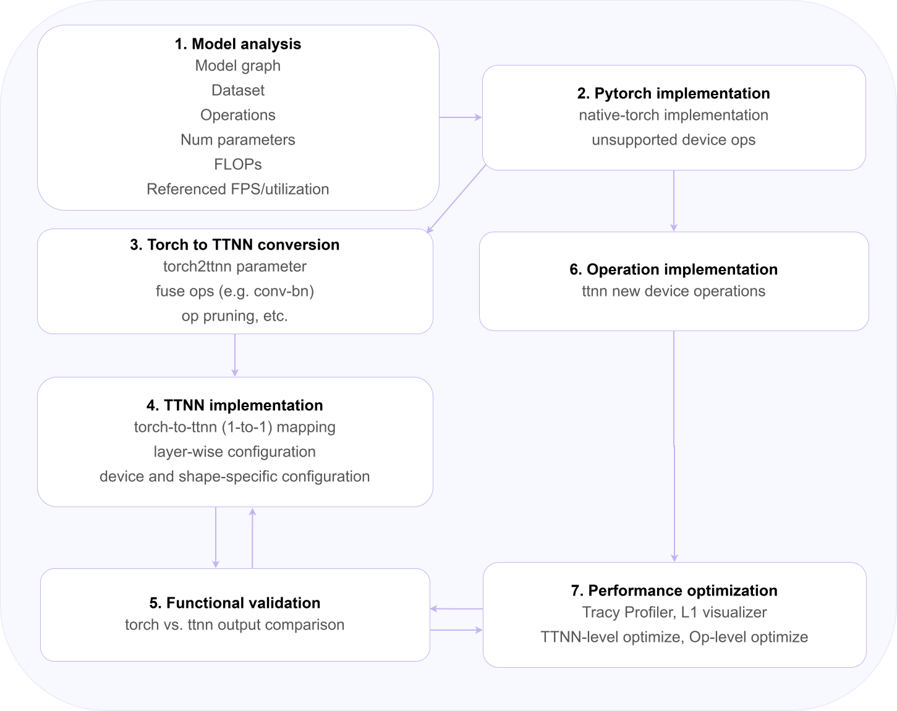

# Manual Model Implementation

This page outlines the hand-crafted model development flow for BOS NPU deployment. It describes how teams move from model analysis and PyTorch baselines to TTNN implementation. The process emphasizes functional validation at each stage to preserve model correctness. It also highlights when custom operations are required for unsupported behavior. The final stage focuses on performance optimization using profiling and hardware-aware tuning.

| No. | Step | Description | 
|---|---|---|
| 1 | Model analysis | Evaluate the model architecture, parameters, and baseline metrics (e.g., FLOPs, dataset characteristics) to establish performance expectations. Additionally, deep understanding of model architecture design intuition/techniques is also important. | 
| 2 | PyTorch implementation | Develop and validate the original model using PyTorch, ensuring correct functionality and establishing reference outputs and behavior. | 
| 3 | Torch to TTNN conversion | Convert the PyTorch model to TTNN by mapping parameters and fusing operations (e.g., conv-bn), and more. This step ensures a one-to-one correspondence where applicable. | 
| 4 | TTNN implementation | Build the TTNN model by configuring each layer with device- and shape-specific settings, replicating the original architecture within the TTNN framework. | 
| 5 | Functional Validation | Compare outputs between the PyTorch and TTNN models using shape and value comparisons (comparison metrics such as PCC), and perform module-wise tests to verify that all functionalities are correct. | 
| 6 | Operation implementation | Implement TTNN-specific operations if not supported. | 
| 7 | Performance Optimization | Optimize individual modules using built-in methods offered by TT-Metal or profiling tools, applying techniques such as operation fusion, pruning, quantization, etc., as needed. | 

## Manual Download

After [requesting access to the git](/docs/AI_Models_SDK/Manual_Model_Implementation/Contact/), access the [Eagle-N Model Implementation Guide](https://github.com/bos-semi-release/Eagle-N-Model-Implementation-Guide).

## 이미지

  <!-- https://developers.bos-semi.com/img/manual_development_worflow_v2.svg -->
  <!-- https://developers.bos-semi.com/img/BOS_Logo_4E_RGB.avif -->
