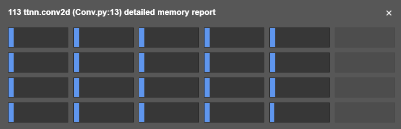
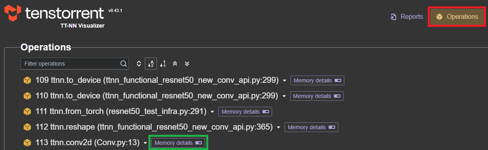
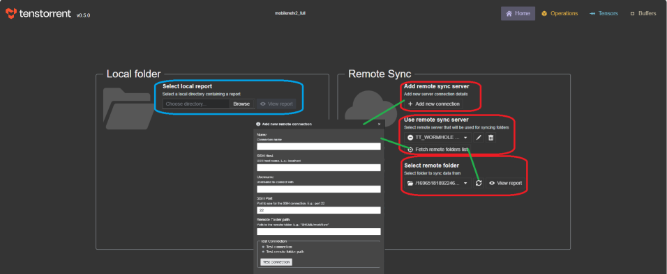
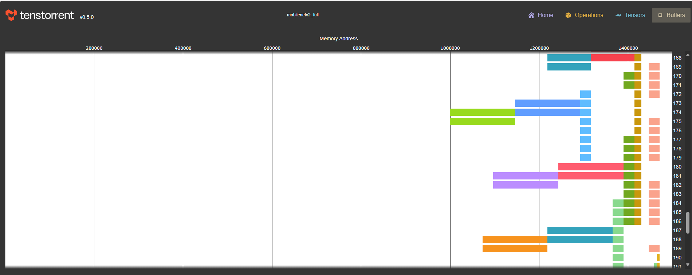
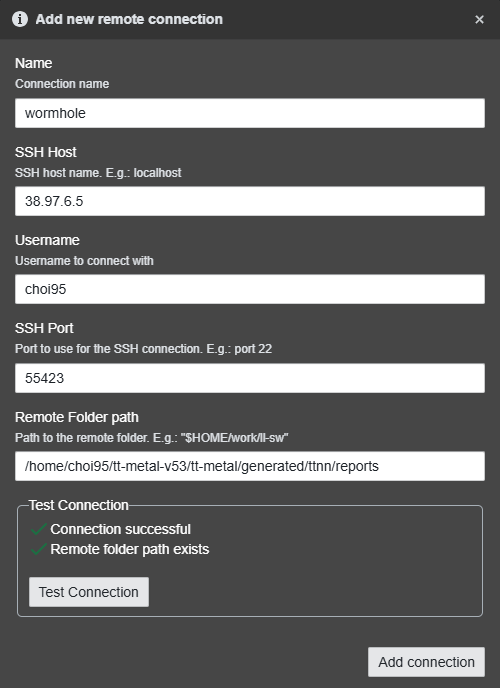
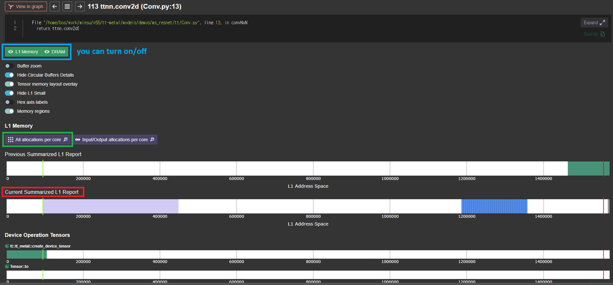

# Memory Visualizer

Memory visualizer (a.k.a L1 visualizer), [Tenstorrent Visualizer](https://github.com/tenstorrent/ttnn-visualizer), is a comprehensive tool for visualizing and analyzing model execution, offering interactive graphs, memory plots, tensor details, buffer overviews, operation flow graphs, and multi-instance support with file or SSH-based report loading.

**Installation guide**

## Prerequisite[](#prerequisite)

You need a Linux environment.

## Installation[](#installation)

- 
Go to your virtual env in the tt-metal folder 
- 
pip install ttnn-visualizer 
- 
(optional) You should add your SSH agent, ensuring it is configured for the target folder you plan to use. `eval $(ssh-agent)`
 ssh-add ~/.ssh/id_rsa
- 
Run $ ttnn-visualizer and go to 127.0.0.0:8000 

# How to Open Project

Before fetching l1 visualizer data from remote server, run your model with these environment variables.

```
    export TTNN_CONFIG_OVERRIDES='{
        "enable_fast_runtime_mode": false,
        "enable_logging": true,
        "enable_graph_report": false,
        "report_name": "<name of the run in the visualizer>",
        "enable_detailed_buffer_report": true,
        "enable_detailed_tensor_report": false,
        "enable_comparison_mode": false
    }'
```
Then, directory "/to/your/tt-metal/generated/ttnn/reports" is created. You're going to fetch this.

## Remote Access[](#remote-access)

- First, click add_new_connection button.
- Fill up the pop-up.
- After establishing the connection, click fetch folder list.
- Folders are fetched, but the data aren't transferred. Click recycle button next to your folder name. That will fetch data inside the folder.
- See your reports.
- Your data is stored in ./virtual_env/lib/python3.10/site-packages/ttnn_visualizer/data/remote.
- Those reports can be shown by clicking Select local report button.

## Download the report folder from remote server, and run in localhost[](#download-the-report-folder-from-remote-server-and-run-in-localhost)

- $ ttnn-visualizer --profiler-path [DOWNLOADED GENERATED FOLDER]
- go to 127.0.0.0:8000 and then just use.

# How to Use

In the menu at the top, you can observe the memory area through [Operations, Tensors, Buffers, Graphs], and you can usually check the L1 area for each operation by pressing [Memory details] after each Op in the [Operations] menu.

## 이미지

  <!-- https://bos-semi-demo-contents.s3.ap-northeast-2.amazonaws.com/public/howtouse-3.png -->
  <!-- https://bos-semi-demo-contents.s3.ap-northeast-2.amazonaws.com/public/howtouse-1.png -->
  <!-- https://bos-semi-demo-contents.s3.ap-northeast-2.amazonaws.com/public/howtoprojectopen-1.png -->
  <!-- https://bos-semi-demo-contents.s3.ap-northeast-2.amazonaws.com/public/l1_buffer_visualizer.png -->
  <!-- https://developers.bos-semi.com/img/BOS_Logo_4E_RGB.avif -->
  <!-- https://bos-semi-demo-contents.s3.ap-northeast-2.amazonaws.com/public/howtoprojectopen-2.png -->
  <!-- https://bos-semi-demo-contents.s3.ap-northeast-2.amazonaws.com/public/howtouse-2.png -->
