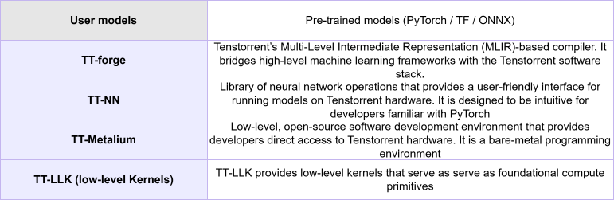
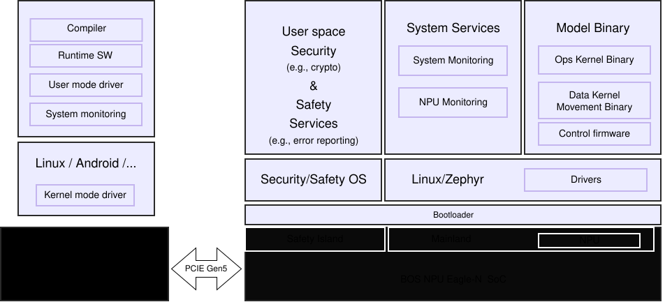

# AI Software Stack

BOS SoC are optimized for processing complex AI workloads such as video and text analysis, supported by a distributed software stack spanning both the host machine and the BOS SoC.

The BOS AI software stack is deployed across a Linux-based host system and the BOS SoC, connected via a high-bandwidth PCIe Gen5 interface. The host AP, either x86 or ARM-based, manages system orchestration, data handling, and model execution flow, while BOS SoC performs compute-intensive neural network inference.

## Execution flow of AI workloads:

- The host machine sends input data (camera, sensor, or text streams) to BOS SoC via PCIe
- BOS SoC executes neural network models to do inference using its multi-cluster NPU
- Results are returned to the host machine for further decision-making or service integration

## Host machine and BOS SoC device software stack configuration:

- Support for both x86 and ARM host machine platforms
- Requires a bare-metal Linux and Android environment on the host machine
- Two different software stacks: one for the host machine and the other for the BOS SoC
- Support functional safety aligned with ISO 26262 for reliable operations

This tightly integrated hardware-software architecture enables efficient workload distribution, high-throughput data processing, and robust system reliability for automotive and edge AI applications.

## Tenstorrent-BOS AI Software

### TT-Forge™: MLIR-Based Compiler

TT-Forge™ is Tenstorrent’s Multi-Level Intermediate Representation (MLIR)-based compiler. It bridges high-level machine learning frameworks with the Tenstorrent software stack.

Use TT-Forge™ to compile models from frameworks such as PyTorch, JAX, and TensorFlow for execution on Tenstorrent hardware. It offers an automated, general path to run many types of model architectures without requiring custom kernel development. TT-Forge™ integrates with and lowers to TT-Metalium for hardware execution.

### TT-NN™: A Python & C++ Neural Network OP library

TT-NN™ is a library of neural network operations that provides a user-friendly interface for running models on Tenstorrent hardware. It is designed to be intuitive for developers familiar with PyTorch.

Use TT-NN™ to run AI models using a familiar, high-level Python API without managing the complexities of the underlying hardware. TT-NN™ builds upon TT-Metalium™ and provides a stable set of pre-packaged, optimized operations. It is also available with a C++ API.

### TT-Metalium™: Programming Tenstorrent Hardware

TT-Metalium™ is the low-level, open-source software development kit (SDK) that provides developers direct access to Tenstorrent hardware. It is a bare-metal programming environment designed for users who must write custom C++ kernels for machine learning or other high-performance computing workloads. It is comparable to Nvidia's CUDA or AMD's HIP.

Use TT-Metalium™ when you require complete control over the hardware to optimize code for performance, explicitly manage memory, or implement novel operations not found in standard libraries. This environment exposes the RISC-V processors, the Network-on-Chip (NoC), and the matrix and vector engines within each Tensix core.

### TT-LLK: Low-level kernels

TT-LLK provides low-level kernels that serve as foundational compute primitives, acting as building blocks for higher-level software stacks that implement machine learning (ML) operations.

## Advantages of BOS Neural Network Software

BOS SoC’s focus fully on parallel programming. They achieve high-performance inference and utilization for current AI models while remaining flexible and programmable. They support efficient tile-based compute and data movement, providing interleaved and shared buffer management for compute operations such as element-wise, matmul, reduction, and window-based operations.

Four major advantages of BOS NPU system are:

### Near Memory Compute and Efficient Use of SRAM

Eagle-N’s NPU, for example, is composed of 24 AI compute engines, called Tensix cores, each with 5 RISC-V CPUs, forming a mesh topology.

- Each Tensix core operates on its local SRAM.
- Tensix cores are connected via two NoCs (Networks-on-Chip).
- Each core can communicate with:
- Any other Tensix core in the mesh
- Off-chip DRAM
 
- The entire SRAM is used as intermediate storage between operations.

### Explicit and Decoupled Data Movement

The performance and efficiency of data movement in AI are as important as the raw compute capacity of the math engines.

- In Tensix, data movement is explicit and decoupled from compute.
- Separate data movement engines in each Tensix core:
- Transfer data from neighboring cores or off-chip DRAM
- Store data into local SRAM
 
- Data movement RISC-V processors:
- Issue asynchronous, tile-sized data movement instructions
- Enable a large number of outstanding transfers
- Operate concurrently with the compute engine
 

### Flexible Performance Optimization Support

- tt-nn (high-level): Python-based, PyTorch-like interface with built-in optimizations and minimal customization.
- tt-nn + bare-metal: Combines high-level APIs with custom kernel development for deeper optimization.
- Bare-metal: Full low-level programming in C++ for maximum performance, targeting HPC and highly optimized kernels.

### Flexible Configurations of Tensix Clusters

- Enabling the configuration of multiple model execution environments
- Hardware-supported physical partitioning to support freedom from interference (FFI), ready for automotive safety

## 이미지

  <!-- https://developers.bos-semi.com/assets/images/tenstorrent_bos_sw_stack2-442fd96ae521a01245e8078023002621.svg -->
  <!-- https://developers.bos-semi.com/assets/images/bos_npu_sw_architecture_final-185dcdc6ae38d88c3440839e4d41d030.svg -->
  <!-- https://developers.bos-semi.com/img/BOS_Logo_4E_RGB.avif -->
