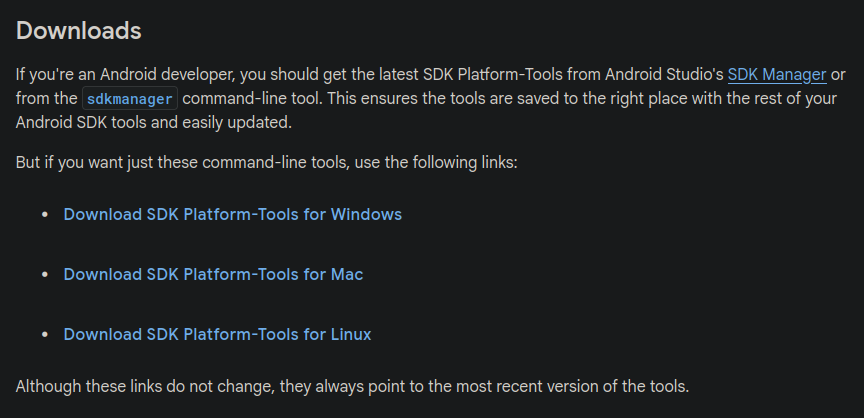
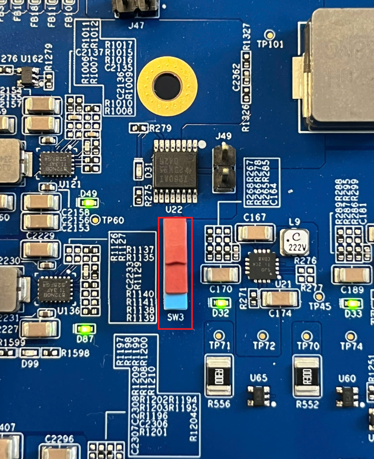
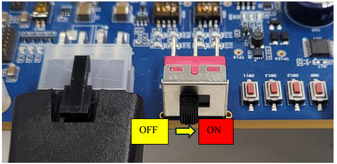
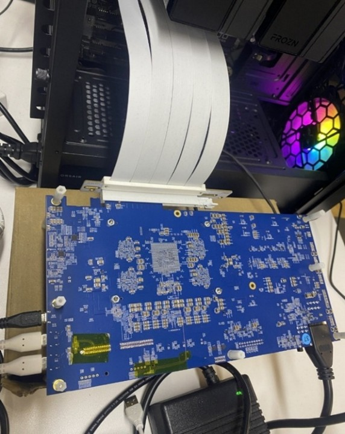
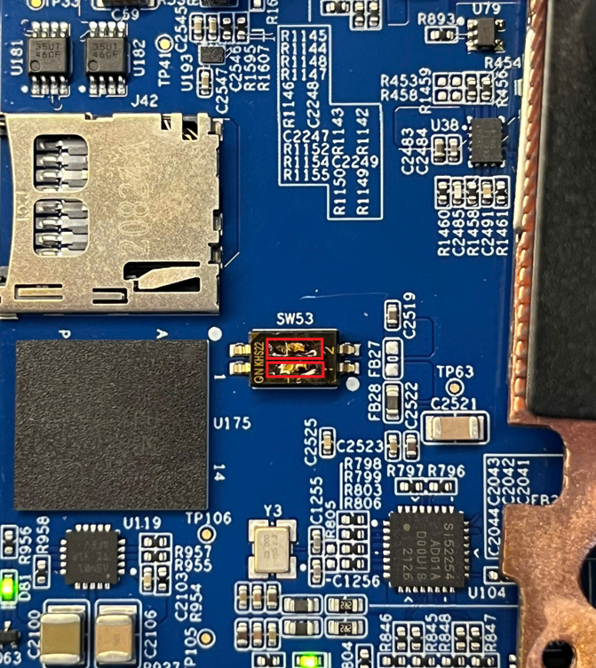
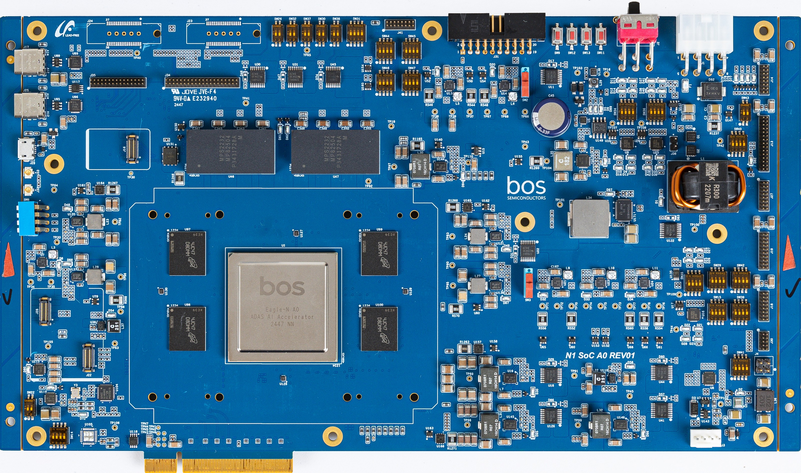

# NN Accelerator Setup

Essential steps and guides for configuring the Eagle-N evaluation board and target device for BOS AI SDK deployment. Includes board setup, image flashing, and hardware verification procedures for different installation methods.

## How to Setup Eagle-N A0 Eval. Board[](#how-to-setup-eagle-n-a0-eval-board)

### How to Set up Environment[](#how-to-set-up-environment)

#### Eagle-N A0 Eval. Board Overview[](#eagle-n-a0-eval-board-overview)

### Power requirements

- Input voltage: 100 ~ 240 V - 6.0 A
- Frequency: 50/60 Hz
- Output voltage: 12 V, 20 A

### Booting modes

- From PCIE
- From SD/MMC
- From QSPI

#### Eagle-N A0 Eval. Board Setup Environment to run AI models[](#eagle-n-a0-eval-board-setup-environment-to-run-ai-models)

Due to the form factor, the Eagle-N A0 Eval. board may not be directly inserted into PCIe Slot on the motherboard of host PC. A PCIe riser cable may be used with the Eagle-N evaluation board. The board package should be used to connect Eagle-N A0 board and host PC as shown in *Figure 1*.

##### Host PC and Eagle-N A0 System Requirements

| Host PC Requirements | |
|---|---|
| CPU | x86 over 8 CPU cores | 
| Memory | Over 32GByte | 
| PCIE version | Gen3 or above | 
| OS version | Ubuntu 22.04 | 

##### Host PC BIOS Setting[](#host-pc-bios-setting)

Since the Eagle-N A0 board uses the clock provided by the host, the boot sequence between the host PC and the Eagle-N A0 board must be synchronized. Therefore, the Eagle-N A0 board is designed to wake the host PC through a wakeup signal from the PCIe endpoint. As a result, the BIOS settings on the host PC need to be modified according to the values shown in the two tables below. Note that at present, the GIGABYTE BIOS is the only configuration that has been officially validated for use as a host PC. Although other BIOS types may operate correctly when configured in a similar manner, their compatibility with the current Eagle-N A0 software version has not been verified yet.

| Item | Setting value | 
|---|---|
| Wake on PCIe / Wake from PCIe | Enable | 
| PME Event Wake Up | Enable | 
| S5 Wake on PME | Enable | 

`lspci -v` shows the evaluation board information when the board and Host PC are successfully connected.

- The default BAR size of Eagle-N A0 evaluation board is **128MB**`$ lspci -v`
 01:00.0 Co-processor: Synopsys, Inc. DWC_usb3 / PCIe bridge
 Flags: bus master, fast devsel, latency 0, IRQ 156
 Memory at a8000000 (32-bit, prefetchable) [size=128M]
 Memory at a0000000 (32-bit, prefetchable) [size=128M]
 Memory at b0000000 (32-bit, prefetchable) [size=2M]
 Capabilities: <access denied>
 Kernel driver in use: bos
 Kernel modules: bos

#### How to Boot the Eval. board[](#how-to-boot-the-eval-board)

There are four steps to get the Eagle-N A0 evaluation board started with host PC.

- Connect a host PC and Eagle-N A0 eval. board using a PCIe cable. Connect USB-to-type C cables to see the console logs. There are two type C and one microUSB (a.k.a type B) ports on the board as *figure 1*.
 Each of the cables supports two ports, so there will be 4 serial ports as shown below once you connect the cables to host PC and Eagle-N A0 board. The console terminal can be opened for each of the serial ports shown below.`$ ll /dev/ttyUSB*`
 crw-rw---- 1 root dialout 188, 0 Nov 3 17:42 /dev/ttyUSB0
 crw-rw---- 1 root dialout 188, 1 Nov 3 17:42 /dev/ttyUSB1
 crw-rw---- 1 root dialout 188, 2 Nov 3 17:42 /dev/ttyUSB2
 crw-rw---- 1 root dialout 188, 3 Nov 3 17:42 /dev/ttyUSB3

- Eagle-N A0 eval. board booting.
 Initially, booting images are fused on NOR flash and eMMC (as default) on the eval. board when the board is shipped. Once the board is powered on, the boot process starts automatically, and after completion, the system boots directly into the Linux kernel. The serial port,`/dev/ttyUSB0`, shown below, could vary. To log into the Linux Kernel, use the following account and password:- username: `root`
- password: `bossemi`.
 `Poky (Yocto Project Reference Distro) 4.0.21 n1bos /dev/ttyS0`
 n1bos login: root
 password:
 root@n1bos:~#
- username: 

- If any key is hit during the Uboot and return to the Uboot prompt, to boot from Uboot to Linux kernel, use below command:
`Hit any key to stop autoboot: 0`
 u-boot =>
 u-boot => run bootcmd_bootwithmode

##### Checking PCIe link connection status[](#checking-pcie-link-connection-status)

Run `lspci -v` command from the terminal in the host PC, then “Synopsis, Inc. DWC_usb3..” should be found from the output results shown below.

- 
In the case of a 128MB BAR size `$ lspci -v`
 01:00.0 Co-processor: Synopsys, Inc. DWC_usb3 / PCIe bridge
 Flags: bus master, fast devsel, latency 0, IRQ 156
 Memory at a8000000 (32-bit, prefetchable) [size=128M]
 Memory at a0000000 (32-bit, prefetchable) [size=128M]
 Memory at b0000000 (32-bit, prefetchable) [size=2M]
 Capabilities: <access denied>
 Kernel driver in use: bos
 Kernel modules: bos
- 
In the case of a 512MB BAR size `$ lspci -v`
 01:00.0 Co-processor: Synopsys, Inc. DWC_usb3 / PCIe bridge
 Flags: bus master, fast devsel, latency 0, IRQ 156
 Memory at 60000000 (64-bit, prefetchable) [size=512M]
 Memory at 48000000 (64-bit, non-prefetchable) [size=128M]
 Memory at 50000000 (32-bit, non-prefetchable) [size=2M]
 Capabilities: <access denied>
 Kernel driver in use: bos
 Kernel modules: bos

## How to Fuse New Images[](#how-to-fuse-new-images)

Step-by-step guide for updating the Eagle-N evaluation board with new bootloader and kernel images using USB fastboot. Covers fastboot setup, driver installation, image preparation, and board flashing procedures for system updates.

In the case that the board needs to boot up with new booting images, the current booting images on flash areas should be replaced with new booting images. USB fastboot is used for booting image update which is a tool within the android framework. To use the USB fastboot, a corresponding driver, called android driver, should be installed on host PC too.

The steps below show how to install the android driver on host PC and how to download new booting binary images to the boards using USB fastboot.

### Step 1: Setting the configuration of fastboot on host PC with Ubuntu[](#step-1-setting-the-configuration-of-fastboot-on-host-pc-with-ubuntu)

- 
Installing fastboot Download android platform-tools from [SDK Platform Tools release page](https://developer.android.com/tools/releases/platform-tools)Unzip the downloaded archive to the proper location.( eg. `/home/bos/android/`)`$ unzip platform-tools-latest-linux.zip`
 Archive: platform-tools-latest-linux.zip
 inflating: platform-tools/NOTICE.txt
 inflating: platform-tools/adb
 inflating: platform-tools/etc1tool
 inflating: platform-tools/fastboot
 inflating: platform-tools/hprof-conv
 inflating: platform-tools/lib64/libc++.so
 inflating: platform-tools/make_f2fs
 inflating: platform-tools/make_f2fs_casefold
 inflating: platform-tools/mke2fs
 inflating: platform-tools/mke2fs.conf
 extracting: platform-tools/source.properties
 inflating: platform-tools/sqlite3
 $ ls platform-tools
 lib64/ fastboot* mke2fs*
 NOTICE.txt hprof-conv* mke2fs.conf
 adb* make_f2fs* source.properties
 etc1tool* make_f2fs_casefold* sqlite3*To make it easier to user, add the directory to the `PATH``$ export PATH=$PATH:/home/bos/android/platform-tools`Make sure the version of the installed package is '35.0.2-12147458' or later. `$ fastboot --version`
 fastboot version 36.0.0-13206524
 Installed as /home/bos/android/platform-tools/fastboot

- 
Adding device information by executing `fastboot_usb.sh`so that**fastboot**can recognize the USB device.Setting necessary permissions for **fastboot**to use when the Eagle-N A0 board is connected as USB device.Execute `fastboot_usb.sh`. While the script runs, the`root`privilege is required to create`/etc/udev/rules.d/51-android.rules`file. The script is covered.`$ cat fastboot_usb.sh`
 #!/bin/bash
 mkdir ~/.android
 cd ~/.android
 echo 0x3816 >> adb_usb.ini
 sudo wget -O /etc/udev/rules.d/51-android.rules https://raw.githubusercontent.com/NicolasBernaerts/ubuntu-scripts/master/android/51-android.rules
 echo -e "# BOS\nSUBSYSTEM==\"usb\", ATTR{idVendor}==\"3816\", MODE=\"0666\", GROUP=\"plugdev\"" | sudo tee -a /etc/udev/rules.d/51-android.rules
 sudo chmod a+r /etc/udev/rules.d/51-android.rules

- Reboot the host PC.

### Step 2: Connecting Eagle-N A0 eval. board to host PC[](#step-2-connecting-eagle-n-a0-eval-board-to-host-pc)

*Figure 1* shows how to connect PC with Eagle-N A0 eval. board to download booting images using USB Type B cable for image download and USB Type C for console, respectively.

**NOTE**: Confirm that the USB cables should support data transmission.( Do NOT use the cables that support only charging )

To download new booting binaries, **fastboot** packages should be installed on the host PC. The Eagle-N A0 eval. board should be connected to Eagle-N A0 eval. board first and Eagle-N A0 eval. board should be entered into **fastboot** mode during **uboot** phase.

### Step 3: Booting into USB fastboot mode.[](#step-3-booting-into-usb-fastboot-mode)

- Perform a power-on reset by turning on the power switch. Note that Eagle-N A0 eval. board should be connected to host PC before turning on the power switch.

Figure 3. Eagle-N A0 board power switch

- Entering **uboot**command mode. After performing a power-on reset, you can see the console logs as shown below and when you see the message`Hit any key to stop auto boot:`, press any key to enter the**uboot**command mode. Then you can see**uboot**command shell prompt,`u-boot=>`.`Hit any key to stop autoboot: 0`
 u-boot=>
 u-boot=>

- Configure eMMC/SD card partition by running `gptcrate 0`command.`u-boot=> gptcrate 0`

- Run `fastboot`command as shown below. If you can see`crq->brequest:0x0`(sometimes not shown but that is ok), then Eagle-N A0 is successfully entered into**fastboot**mode. You are now ready to download booting images. (The output message may change or may not be displayed, but if the USB driver is visible on the host PC, it is usable.)Once you run`u-boot=>`
 u-boot=> fastboot 0
 fastboot_buf_addr: 0x0000000095000000
 fastboot_buf_size: 0x0000000020000000
 serial# : EAGLE-N1-A0-FFFFFFFE`fastboot 0`, the device is ready for receiving booting images from host PC.

- Check if Eagle-N A0 is detected as USB device on the PC using “lsusb” command. If it is detected, `BOS Eagle N Bootloader Interface`should be displayed as shown below.`$ lsusb`
 Bus 002 Device 001: ID 1d6b:0003 Linux Foundation 3.0 root hub
 Bus 001 Device 026: ID 10c4:ea70 Silicon Labs CP2105 Dual UART Bridge
 Bus 001 Device 023: ID 214b:7250 Huasheng Electronics USB2.0 HUB
 Bus 001 Device 010: ID 3816:1000 BOS Eagle N1 Bootloader Interface
 Bus 001 Device 009: ID 26ce:01a2 ASRock LED Controller
 Bus 001 Device 001: ID 1d6b:0002 Linux Foundation 2.0 root hub

- Check if `fastboot devices`are correctly detected`$ fastboot devices`
 EAGLE-N1-A0-FFFFFFFE Android Fastboot

- If it doesn't work, check if each of the files, `adb_usb.ini`and`51-android.rules`, is properly created and contains the correct content.`$ cat ~/.android/adb_usb.ini`
 0x3816
 $ cat /etc/udev/rules.d/51-android.rules
 ...
 # BOS
 SUBSYSTEM=="usb", ATTR{idVendor}=="3816", MODE="0666", GROUP="plugdev"

### Step 4: Check the switches of Eagle-N A0[](#step-4-check-the-switches-of-eagle-n-a0)

To switch the partition between eMMC and SD card, choose the corresponding switch as below:

**1. SW53**

a. 1, 2 LEFT: SD card

b. 1, 2 RIGHT: eMMC

Figure 4. SW 53

**2. SW3**

a. UP: eMMC

b. DOWN: SD card

Figure 5. SW3

The user can check the selected partition from **uboot** with `mmc info` command.

- 
in case of using eMMC `u-boot=> mmc info`
 Device: sdhci@20600000
 Manufacturer ID: 13
 OEM: 4e
 Name: AAM20E
 Bus SPeed: 52000000
 Mode: MMC High Speed (52MHz)
 Rd Block Len: 512
 MMC version 5.1
 High Capacity: Yes
 Capacity: 29.6 GiB
 Bus Width: 8-bit
 Erase Group Size: 512 KiB
 HC WP Group Size: 8 MiB
 User Capacity: 29.6 GiB WRREL
 Boot Capacity: 31.5 MiB ENH
 RPMB Capacity: 4 MiB ENH
- 
in case of using SD card `u-boot=> mmc info`
 Device: sdhci@20600000
 Manufacturer ID: 1b
 OEM: 534d
 Name: EC1S5
 Bus SPeed: 52000000
 Mode: SD High Speed (50MHz)
 Rd Block Len: 512
 SD version 3.0
 High Capacity: Yes
 Capacity: 59.7 GiB
 Bus Width: 4-bit
 Erase Group Size: 512 Bytes

### Step 5: Fastboot download commands[](#step-5-fastboot-download-commands)

After selecting the eMMC/SD card partition, the `fastboot flash` command is used to download the above images from host PC to the selected partition:

You can check the serial number with `fastboot devices` first, and then, download the images to the evaluation board.

```
$ fastboot devices
EAGLE-N1-A0-FFFFFFFE      Android Fastboot
```
```
$ fastboot -s EAGLE-N1-A0-FFFFFFFE flash package n1-bip-vxx.bin
Warning: skip copying package image avb footer (package partition size:0, package image size: 1604608)/
Sending 'package' (1567 KB)                    OKAY[   0.115s]
Writing 'package'                              OKAY[   5.842s]
Finished. Total time: 5.958s
```
If host PC is connected with only one Eagle-N A0 eval. board, you don't need to specify the serial number

```
$ fastboot flash package n1-bip-vxx.bin
Warning: skip copying package image avb footer (package partition size:0, package image size: 1604608)/
Sending 'package' (1567 KB)                    OKAY[   2.735s]
Writing 'package'                              OKAY[   5.745s]
Finished. Total time: 8.484s
```
After flashing the image, to boot up the system into Linux, reboot the target board and enter the **uboot** download mode (refer to the step 3-2).

When the board is ready, download other images into the eMMC or SD card on the board:

- Kernel device tree blob (DTB)
- Kernel image
- Root file system

```
$ fastboot flash kerneldtb kernel-vxx.dtb
Sending 'kerneldtb' (36 KB)                    OKAY[   0.009s]
Writing 'kerneldtb'                            OKAY[   0.058s]
Finished. Total time: 0.303s
$ fastboot flash kernel kernel-vxx.img
Sending 'kernel' (240-9 KB)                    OKAY[   0.935s]
Writing 'kernel'                               OKAY[   2.031s]
Finished. Total time: 2.999s
$ fastboot flash rootfs rootfs-vxx.ext4
Sending 'rootfs' (16384 KB)                    OKAY[   1.101s]
Writing 'rootfs'                               OKAY[ 196.529s]
Finished. Total time: 197.665s
```
While downloading the images, you can see the progress from the board.

For example,

```
u-boot=> fastboot 0
fastboot_buf_addr: 0x0000000095000000
fastboot_buf_size: 0x0000000020000000
serial# : EAGLE-N1-A0-FFFFFFFE
Starting download of 1604608 bytes
...........
downloading of 1604608 bytes finished
current version :0.0.0.1, package version: 0.0.0.1
active_slot: A
...
...
----- Partition update is complete!  ---
BIP version is identical, skipping update
Boot meta is identical, skipping update
New image flag set successfully
---------------------------------------
-- Package update was complete !  -----
---------------------------------------
```
### Eagle-N device binaries[](#eagle-n-device-binaries)

The table below shows the list of binaries that need to be fused onto the board. You can download them after [requesting access to the git](/docs/Contact/).

| Partition | Partition name | Image | Description | 
|---|---|---|---|
| Package | package | [n1-bip-v0.1.0.3_patch1119.bin](https://github.com/bos-semi-release/Eagle_N/blob/main/binaries/n1-bip-v0.1.0.3_patch1119.bin) | Total of image | 
| Kernel DTB | kerneldtb | [kernel-v0.1.0.3_patch1119.dtb](https://github.com/bos-semi-release/Eagle_N/blob/main/binaries/kernel-v0.1.0.3_patch1119.dtb) | The DTB of the Kernel | 
| Kernel Images | kernel | [kernel-v0.1.0.3_patch1119.img](https://github.com/bos-semi-release/Eagle_N/blob/main/binaries/kernel-v0.1.0.3_patch1119.img) | Linux Kernel Image | 
| Root File System | rootfs | [rootfs-v0.1.0.3_patch1119.img](https://github.com/bos-semi-release/Eagle_N/blob/main/binaries/rootfs-v0.1.0.3_patch1119.img) | Linux Root File System. sparse image of 512MB RootFS |

## 이미지

  <!-- https://bos-semi-demo-contents.s3.ap-northeast-2.amazonaws.com/public/app-note-android-platformtools-download.png -->
  <!-- https://bos-semi-demo-contents.s3.ap-northeast-2.amazonaws.com/public/app-note-figure-18.png -->
  <!-- https://bos-semi-demo-contents.s3.ap-northeast-2.amazonaws.com/public/app-note-figure-16.png -->
  <!-- https://developers.bos-semi.com/img/BOS_Logo_4E_RGB.avif -->
  <!-- https://bos-semi-demo-contents.s3.ap-northeast-2.amazonaws.com/public/app-note-figure-12.jpg -->
  <!-- https://bos-semi-demo-contents.s3.ap-northeast-2.amazonaws.com/public/app-note-figure-17.png -->
  <!-- https://developers.bos-semi.com/img/Eagle_N_top.jpg -->
