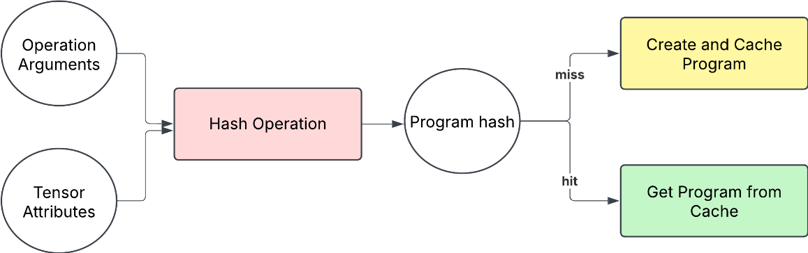
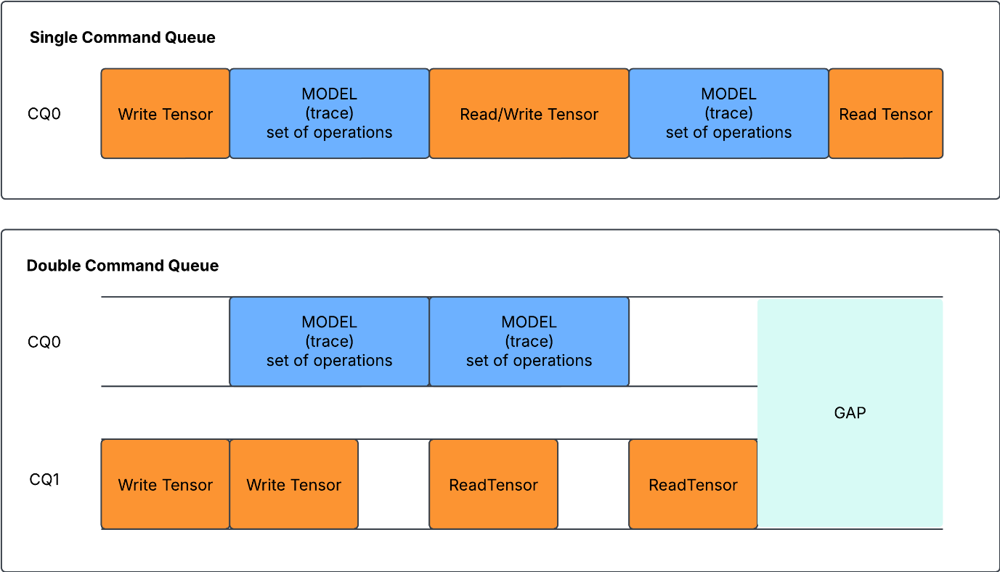
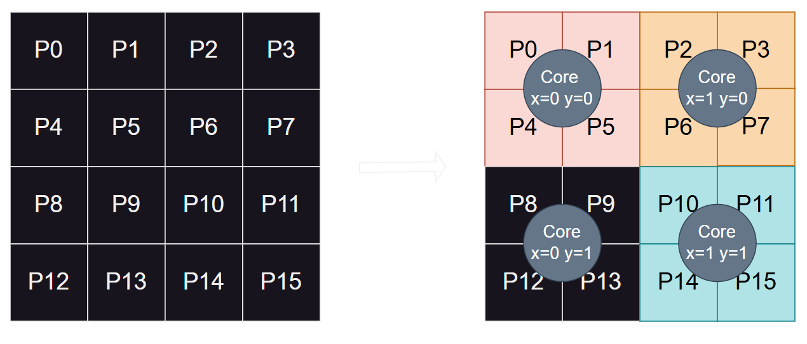
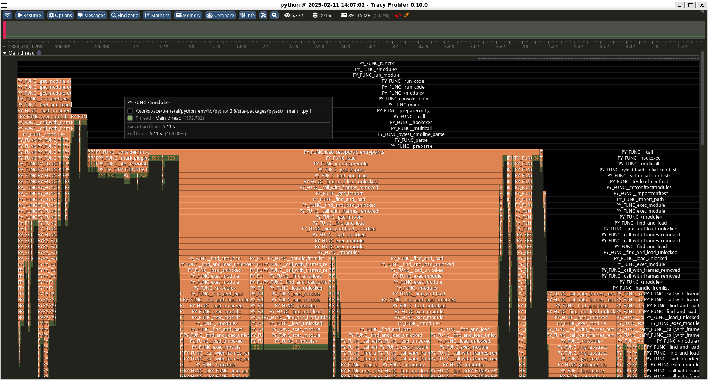
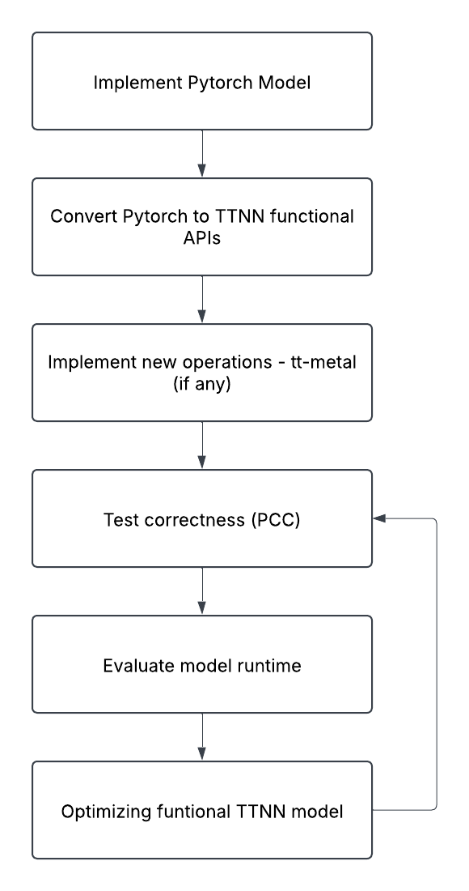

# NPU Programming Guide

This one-page summary is meant to accompany the **NPU programming guide** as a download handoff.
After [requesting access to the git](/docs/Contact/), download the [NPU Programming Guide PDF](https://github.com/bos-semi-release/NPU_Programming_Guide/blob/main/NPU%20programming%20guide%20v1.0.pdf).

## What The Guide Covers

The guide is a practical developer manual for programming BOS platforms built on top of the Tenstorrent NPU software stack. It explains:

- how to prepare the development environment
- what TT-Metal and TTNN are responsible for
- how tensors are represented, padded, tiled, and sharded
- how host-side and kernel-side programming fit together
- how model bring-up, validation, runtime evaluation, and optimization are expected to flow
- which debug and profiling tools are available during development

## Why It Matters

The document is useful because it is not just an API dump. It connects the main layers of the stack:

- **environment setup**for getting the toolchain ready
- **tensor fundamentals**for understanding memory layout and execution behavior
- **TTNN programming flow**for turning a PyTorch model into a working NPU implementation
- **runtime concepts**such as program cache and command queues
- **debugging and profiling tools**such as Tracy and visualization utilities

## Key Takeaways

### 1. Tensor shape and padding are foundational

The guide spends time on how tensor dimensions map into tiles and why padded shapes matter for execution.

### 2. Sharding and layout affect performance

It shows how pages of a tensor are distributed across cores and memory resources, which is critical for scaling and optimization.

### 3. TTNN development follows a staged workflow

The document gives a clear model-development path: start from a PyTorch implementation, convert to TTNN functional APIs, add custom operations when needed, validate correctness, evaluate runtime, and optimize.

### 4. Runtime behavior is part of the programming model

Program caching and queueing are presented as practical runtime concepts rather than hidden internals.

### 5. Tooling is central, not optional

The guide highlights profiling and monitoring tools that help engineers understand what the runtime is doing and where performance can improve.

## Main Sections At A Glance

| Section | Focus | 
|---|---|
| Introduction | Scope of the guide and where TT-Metal / TTNN fit | 
| Prerequisites | Firmware, tools, and installation choices | 
| Development Environment Setup | Bringing up the software stack | 
| TTNN | Tensor model, data types, layouts, and memory behavior | 
| Programming Flow | Host programming, kernel programming, and operation bring-up | 
| Monitor and Debug | Profiling, visualization, and runtime inspection | 
| TTNN API List | Device, memory config, operations, conversion, and reports | 

## Best Use Of This Guide

This guide is best used as:

- an onboarding document for engineers new to the BOS NPU stack
- a bridge between model developers and low-level runtime concepts
- a reference when moving from model correctness to runtime optimization
- a companion download for teams evaluating the programming model

## Suggested Download Positioning

If you present this document as a download, the best positioning is:

A practical introduction to the BOS / Tenstorrent NPU programming stack, from setup and tensor fundamentals to TTNN development flow, runtime behavior, and profiling tools.

## 이미지

  <!-- https://developers.bos-semi.com/assets/images/program-cache-a24bc654f637dd0b57838933f91b29c6.png -->
  <!-- https://developers.bos-semi.com/assets/images/command-queue-2c15e589e2d01e88a45f0a578cd41c7b.png -->
  <!-- https://developers.bos-semi.com/assets/images/tensor-sharding-c2ffda707a4a71685604d743f29c9467.png -->
  <!-- https://developers.bos-semi.com/assets/images/tracy-ui-993f158e17f18f76a466ba4a88e17e68.png -->
  <!-- https://developers.bos-semi.com/img/BOS_Logo_4E_RGB.avif -->
  <!-- https://developers.bos-semi.com/assets/images/ttnn-flow-fcc9a621c9a07586751095013ebdba87.png -->
