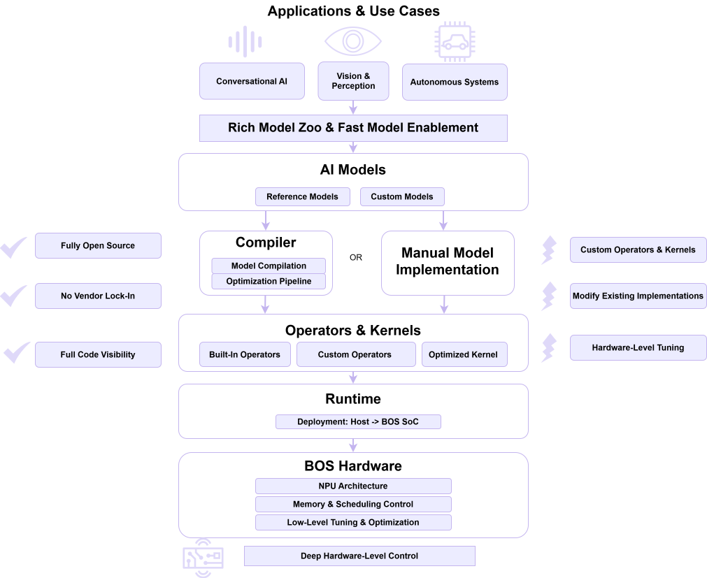
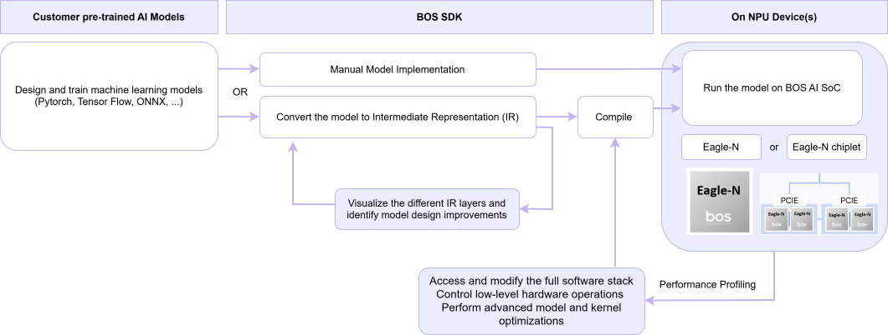

# Overview

From model development to deployment—build and optimize AI models on BOS SoCs with a unified, production-ready software stack.

The AI model SDK provides a comprehensive toolkit for developing and optimizing AI models on BOS SoCs. It enables seamless support for conversational AI, perception models, and autonomous systems by bridging model development, compilation, and deployment across both host systems and the BOS AI accelerator.

Designed for efficiency and flexibility, the SDK streamlines the entire pipeline—from model preparation to high-performance on-device execution.

## Core advantages of BOS AI model SDK

- 
Fully open-source foundation 
 Unlike conventional NPU SDKs, BOS SoCs are built on an open-source stack—giving developers full visibility, control, and freedom from vendor lock-in.
- 
Custom operator & kernel development 
 Easily develop your own operators and kernels to support new models or specialized workloads.
- 
Performance-driven customization 
 Modify and optimize existing operators and kernels to maximize performance for your specific use cases.
- 
Deep hardware-level control 
 Go beyond high-level abstractions—directly tune hardware-specific components for full-stack optimization. While this requires architectural expertise, our team provides dedicated support to help you fully leverage BOS SoCs.
- 
Rich model zoo & rapid model enablement 
 Access a wide range of reference models and quickly adopt newly emerging AI models from industry and academia, supported by a global network of model development experts.

## Designed for Developers

The SDK is built with developer productivity and system-level integration in mind:

- Clean and modular software architecture spanning host and accelerator
- Support for standard environments (Linux, Android)
- Runtime, driver, and toolchain integration for end-to-end workflows
- Built-in profiling, logging, and observability for performance tuning
- Support for asynchronous execution and efficient data movement

This design allows developers to move from experimentation to production while maintaining visibility into system behavior and performance.

## Core Features

Unlock maximum performance on BOS SoCs with hardware-aware optimizations and full-stack control. The SDK enables developers to go beyond standard frameworks and directly tune execution down to the NPU level, without black-box limitations.

### Advanced Model Performance Optimization Features

- Parallel execution across multi-cluster NPU architecture
- High-bandwidth LPDDR5/5X memory utilization for data-intensive workloads
- Support for multiple data formats (INT8, MXINT4, FP16, FP8) with on-the-fly conversion
- Efficient data movement through NoC and DMA engines
- Fine-grained control of low-level hardware operations
- Optimized memory flow across Tensix cores
- Custom compute kernel optimization for specific workloads

These capabilities enable low-latency, high-throughput inference while giving developers full control to extract the maximum performance from BOS SoCs using transparent and open tooling.

### Custom Ops Development Support

Extend the SDK with custom operations and pipelines tailored to your application:

- Build reusable kernels and model components aligned with NPU execution model
- Define specialized pipelines for perception, language, or multimodal workloads
- Integrate proprietary logic while maintaining compatibility with the SDK runtime

This flexibility enables fine-grained control over performance, scalability, and deployment behavior across different system configurations.

## AI Models Workflow

### AI Workload Processing Flow

BOS SoCs are optimized for processing complex AI workloads such as video and text analysis:

- The host AP sends input data (camera, sensor, or text streams) to AI accelators via PCIe
- The BOS AI accelerators execute neural network inference using a multi-cluster NPU
- Results are returned to the host AP for further decision-making or system integration

This division of responsibilities ensures efficient workload distribution and maximizes overall system performance.

### Functional Safety Integration

For automotive applications, BOS SoCs integrate with a dedicated Safety MCU to meet functional safety requirements:

- Monitors system health and detects operational faults
- Sends alerts to the Safety MCU in case of errors or abnormal behavior
- Enables rapid system-level response to maintain safe operation

This safety mechanism is critical for autonomous driving systems, ensuring reliability under all operating conditions.

For different usage models or advanced requirements please contact BOS through [support](/docs/Contact/).

## 이미지

  <!-- https://developers.bos-semi.com/assets/images/BOS_NN_accelerator_appart-223e4b39ccd16cc8d7c8b67adfc526a3.svg -->
  <!-- https://developers.bos-semi.com/img/simplified_AI_Model_Workflow.svg -->
  <!-- https://developers.bos-semi.com/img/BOS_Logo_4E_RGB.avif -->
