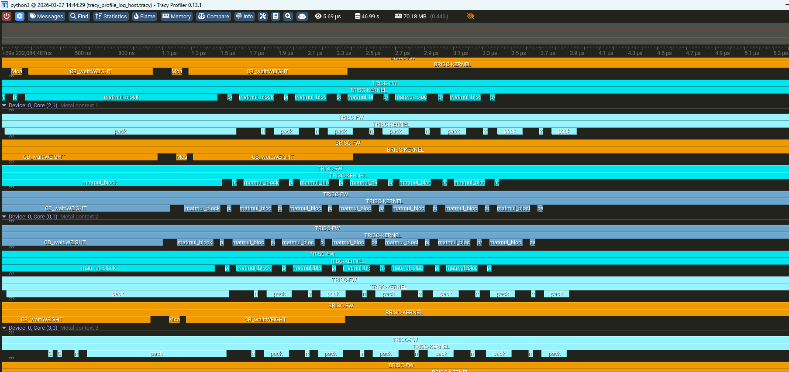
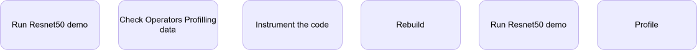
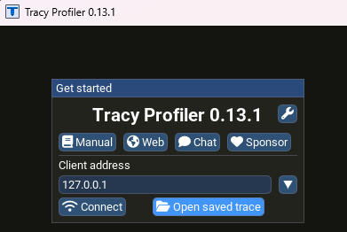

# Profiling an Operator

Learn how to profile individual neural network operators to understand performance characteristics and identify optimization opportunities. This guide uses the Resnet50 model as example and covers profiling tools, visualization techniques, and performance analysis methods for BOS AI accelerators hardware execution.

## Steps Overview[](#steps-overview)

## Build tt-metal with profiler enabled[](#build-tt-metal-with-profiler-enabled)

Please note that building [tt-metal](/docs/Host Machine Setup/#installing-tt-metal) with profiler enabled for is required.

```
git clone --branch=v0.1.0.5 
cd tt-metal
# Install required dependencies (sudo required)
sudo ./install_dependencies.sh
# SET ENV
source env_set.sh
# Build TT-Metal
./build_metal.sh -b Release --enable profiler
## Run Resnet50 demo
```
[[email protected]](/cdn-cgi/l/email-protection):bos-semi-release/tt-metal.git --recurse-submodulesInfo about dependencies

| Package | Version | 
|---|---|
| torch | 2.7.1+cpu | 
| torchvision | 0.22.1+cpu | 
| numpy | 1.26.4 | 
| transformers | 5.4.0 | 
| Pillow | 10.3.0 | 
| cv2 | 4.8.1 | 
| loguru | 0.6.0 | 
| networkx, graphviz, pyyaml, click, pandas, seaborn | ✓ | 
| ttnn | ✓ (via PYTHONPATH) | 

## (Optional) Download ImageNet-1K(validation set)[](#optional-download-imagenet-1kvalidation-set)

- ImageNet-1K is uploaded to "[https://www.kaggle.com/datasets/titericz/imagenet1k-val](https://www.kaggle.com/datasets/titericz/imagenet1k-val)" (Log-in required)

```
unzip imagenet-val.zip -d imagenet-val
```
In order to have a smaller dataset for the profiling demo, I propose to leave only 2 images in imagenet1k-val/imagenet-val2/n01440764

## Run ResNet50 (Image)[](#run-resnet50-image)

More detailed can be found [here](/docs/Validated_Models/Vision/resnet50/)

We will run the demo without screen Use PORT=8461 Save the log in TT_METAL_PROFILER_DIR=/your_report_directory/tracy_reports Take images from --data_dir /your_image_directory/imagenet1k-val/imagenet-val2

```
cd /path/to/tt-metal/ && \
source env_set.sh && \
PORT=8461 && \
(ss -ltn | grep -q ":$PORT " && echo "port $PORT busy" || echo "port $PORT free") && \
ENABLE_TRACY=1 \
TT_METAL_DEVICE_PROFILER=1 \
TT_METAL_DEVICE_PROFILER_DISPATCH=1 \
TT_METAL_PROFILER_DIR=/your_report_directory/tracy_reports \
python -m tracy -r -p -v -t $PORT \
	models/bos_model/resnet50/run_resnet50.py \
	--data_dir /your_image_directory/imagenet1k-val/imagenet-val2 \
	--trace --cq2 -n 1 -b 2
```
## Choose matmul from the csv file[](#choose-matmul-from-the-csv-file)

(You may choose another Operator)

## Instrument the code to profile the selected operator[](#instrument-the-code-to-profile-the-selected-operator)

We are selecting **matmul** in this example,
Edit and Add `DeviceZoneScopedN` in the following files around matmul Operators

- `ttnn/cpp/ttnn/operations/matmul/device/kernels/compute/bmm_large_block_zm_fused_bias_activation.cpp`

- 
**Include the header and enable logging**`#define DEBUG_TRACY_LOG 1`
 #if DEBUG_TRACY_LOG
 #include "tools/profiler/kernel_profiler.hpp"
 #endif
- 
**making a zone**`void MAIN() {`
 ...
 {
 #if DEBUG_TRACY_LOG
 DeviceZoneScopedN("matmul_block");
 #endif
 for (uint32_t inner_dim_idx = 0; inner_dim_idx < in0_block_w; ++inner_dim_idx) {
 matmul_block(
 in0_cb_id, in1_cb_id, in0_index, in1_index, dst_index,
 in1_transpose_tile, out_subblock_w, out_subblock_h, in0_block_w
 );
 in0_index++;
 in1_index += in1_block_w;
 }
 }
 }

- ttnn/cpp/ttnn/operations/matmul/device/kernels/dataflow/reader_bmm_tile_layout_in0_sender_dram_sharded.cpp
- ttnn/cpp/ttnn/operations/matmul/device/kernels/dataflow/reader_bmm_tile_layout_in1_receiver_writer_padding.cpp
- ttnn/cpp/ttnn/operations/matmul/device/kernels/dataflow/reader_bmm_tile_layout_in1_sender_dram_sharded.cpp

## Rebuild TT-metal[](#rebuild-tt-metal)

```
source python_env/bin/activate && ./build_metal.sh --enable-profiler -b Release
```
## Run one more time[](#run-one-more-time)

```
cd /path/to/tt-metal && \
source env_set.sh && \
PORT=8461 && \
(ss -ltn | grep -q ":$PORT " && echo "port $PORT busy" || echo "port $PORT free") && \
ENABLE_TRACY=1 \
TT_METAL_DEVICE_PROFILER=1 \
TT_METAL_DEVICE_PROFILER_DISPATCH=1 \
TT_METAL_PROFILER_DIR=/your_report_directory/tracy_reports \
python -m tracy -r -p -v -t $PORT \
	models/bos_model/resnet50/run_resnet50.py \
	--data_dir /your_image_directory/imagenet1k-val/imagenet-val2 \
	--trace --cq2 -n 1 -b 2
```
## Install tracy on your environment[](#install-tracy-on-your-environment)

In this example, we are using Tracy from the windows laptop

Visit [https://github.com/wolfpld/tracy/releases](https://github.com/wolfpld/tracy/releases) to get the windows installation

Mac users can use brew to install tracy. On your terminal run:

```
brew uninstall tracy #Remove any old version of tracy
wget -P ~/ --no-check-certificate --no-cache --no-cookies https://raw.githubusercontent.com/tenstorrent-metal/tracy/master/tracy.rb
brew install ~/tracy.rb
rm ~/tracy.rb
```
Once installed run tracy GUI with:

```
tracy
```
Building for Linux users

For Linux users, you need to build the Tracy GUI from source. First, clone the Tracy repository.

```
git clone https://github.com/tenstorrent/tracy.git
cd tracy/profiler/build/unix
make -j8
```
A Tracy-release binary will be generated in the current directory after the build completes. You can run it directly from there or copy it to a directory in your PATH for easier access

```
./Tracy-release
```

## 이미지

  <!-- https://developers.bos-semi.com/img/matmul_tracy_profiling.png -->
  <!-- https://developers.bos-semi.com/img/Profiling_an_Operator.svg -->
  <!-- https://developers.bos-semi.com/img/tracy_trace_opener.png -->
  <!-- https://developers.bos-semi.com/img/BOS_Logo_4E_RGB.avif -->
