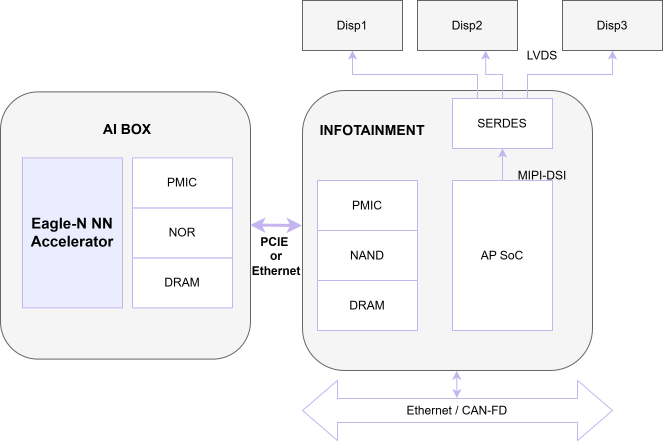
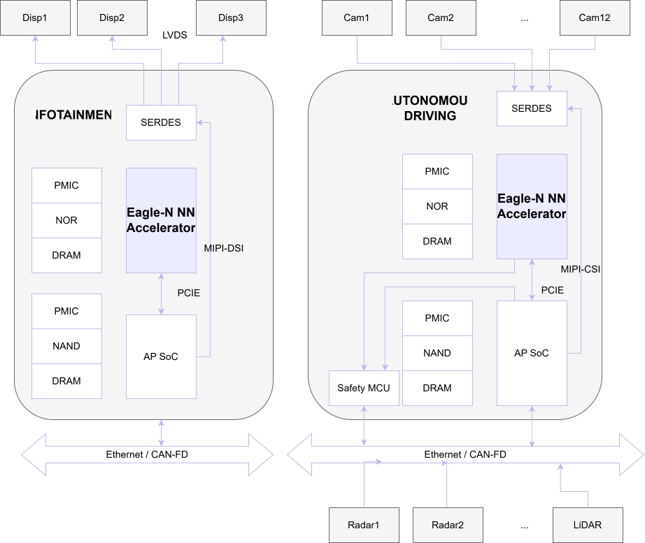
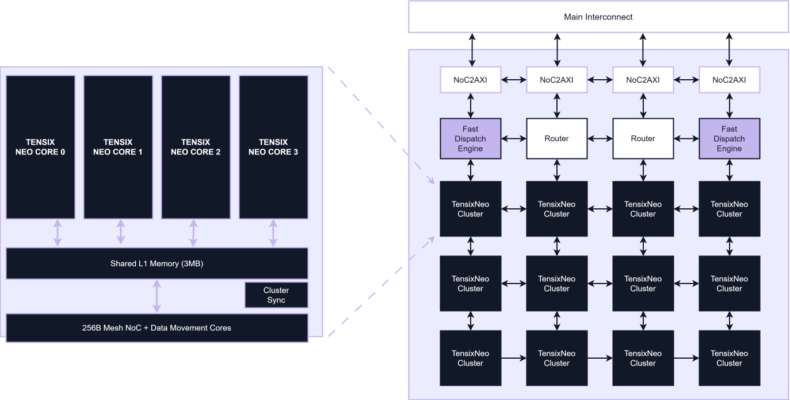
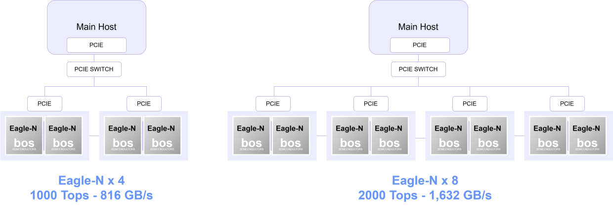

# Eagle-N NN Accelerator

This page provides an overview of the Eagle-N NPU architecture and its key hardware capabilities, as illustrated in the accompanying diagram. It highlights how the system integrates high-performance compute, memory, and interconnect components to deliver efficient AI processing across a wide range of workloads. From detailed hardware specifications to the TensixNeo compute cluster and Network-on-Chip (NoC) design, this section explains how Eagle-N achieves high throughput, scalability, and energy efficiency while supporting modern AI models and data formats.

Eagle-N features a neural network accelerator delivering 250 TOPS performance. It supports high-speed connectivity via PCIe Gen5 (32 GB/s) and UCIe (64 GB/s) for chiplet systems. The SoC is powered by a quad-core ARM Cortex-A53 CPU and LPDDR5/5X memory with 204 GB/s bandwidth. It includes safety features, debugging capabilities, and integrated I/O subsystems. Eagle-N supports INT8, BF16, and MX formats for CNNs, Transformers, and LLMs. Advanced quantization tools reduce model size with minimal (less than 1%) accuracy loss. Efficient use of limited on-chip memory enables streaming-based LLM execution from DRAM. Optimized hardware/software support ensures fast, scalable, and energy-efficient AI inference.

## Eagle-N Technical Specification

Eagle-N A0 is a preliminary version of Eagle-N and not a production-qualified product. There are significant differences in performance and functionality compared to the production version of Eagle-N. The main features upgraded in the production product compared to A0 are as follows:

| Eagle-N A0 | Eagle-N B0 | Remark | |
|---|---|---|---|
| NPU Performance | 64 TOPS | 250 TOPS | Effective fivefold performance improvement | 
| DRAM Bandwidth | 120 GB/s | 204 GB/s | |
| DRAM Capacity | 64 GB | 96 GB | |
| PCIe | 2x Gen5 4-lane 32 GT/s | 1x Gen5 8-lane 32 GT/s (4+4 bifurcation) | |
| UCIe | None | Standard Package 2-module 16GT/s (total 32 pin) | 64 GB/s per direction | 

## Application Scenarios

Eagle-N is designed as a high-performance AI accelerator for automotive and edge systems, enabling efficient deployment of advanced neural network workloads alongside a host application processor (AP).

### System Architecture Overview

At a system level, Eagle-N operates as a dedicated AI compute device that works in conjunction with a host processor:

- Functions as an independent auxiliary SoC with its own PMIC, NOR flash, and DRAM
- Connects to the host AP via PCIe (Gen5), acting as an Endpoint (EP)
- The host AP serves as the Root Complex (RC), managing system control and data flow
- Offloads compute-intensive AI workloads (e.g., vision, language processing) from the host

This architecture allows the host system to focus on orchestration and I/O, while Eagle-N handles high-throughput neural network inference.

### Achieving Scalable NPU Performance

- Supports a wide performance range thanks to multi-device capability
- Capable of running modern models including VLMs and LLMs (e.g., Qwen, Llama)

Several Eagle-N SoCs can be used in parallel to increase TOPS performance and thus run very large models.

### Deployment Scenarios

Eagle-N supports flexible deployment across multiple use cases:

#### ADAS / IVI AI Extension

Enhances existing systems by offloading AI workloads from the main processor.

#### AI Box

- Acts as an external AI compute module
- Enables advanced features such as:
- Voice recognition
- Vision processing
- Intelligent services
- Agentic AI
 

## 3x4 TensixNeo Cluster Architecture

- 
TensixNeo Cluster 
 A compute block made up of multiple TensixNeo cores that serves as the fundamental building unit of the NPU. Each cluster handles a portion of the AI workload and communicates with other clusters through the NoC and routing fabric.
- 
Main Interconnect 
 The top-level communication fabric that connects multiple chips, clusters, or systems together. Provides high-bandwidth, low-latency data exchange Typically implemented via Ethernet or high-speed links in Tenstorrent systems Enables scaling across multiple devices (multi-chip / multi-node)
- 
NoC 
 A communication network inside a chip that connects internal components (cores, memory, engines). Moves tensors, instructions, and activations Designed for parallel, high-throughput data movement
- 
NoC2AXI 
 A bridge between the on-chip network (NoC) and AXI-based interfaces. Converts NoC packets → AXI transactions Used to interface with: Memory controllers External I/O AXI = standard high-performance bus protocol
- 
Fast Dispatch Engine (FDE) 
 A dedicated hardware unit that schedules and dispatches workloads to the Tensix cores while managing command streams and controlling execution flow.
- 
TensixNeo Cluster 
 A compute block made up of multiple TensixNeo cores that serves as the fundamental building unit of the NPU. Each cluster handles a portion of the AI workload and communicates with other clusters through the NoC and routing fabric.

## Supported data formats

| Data Formats | Tensix Neo Trinity lo-fi | Tensix Neo Trinity Hi-Fi | 
|---|---|---|
| FP32, INT32 (accumulation only) | - | - | 
| TF32 | 2048 | 512 | 
| Float16 | 2048 | 512 | 
| Float16_B | 2048 | 2048 | 
| FP8R | - | 2048 | 
| FP8P | - | 2048 | 
| MXFP8R | - | 2048 | 
| MXFP8P | - | 2048 | 
| MXFP6R | - | 2048 | 
| MXFP6P | - | 2048 | 
| MXFP4 | - | 2048 | 
| MXINT8 | - | 2048 | 
| MXINT4 | - | 2048 | 
| MXINT2 | - | 2048 | 
| MXFP4 | - | 2048 | 
| INT8 | - | 8192 | 
| UINT8 | 8192 | 8192 |

## 이미지

  <!-- https://developers.bos-semi.com/assets/images/AI-Box-ef2d4c569cbb94f7d9d1e4838a8508f5.svg -->
  <!-- https://developers.bos-semi.com/img/BOS_Logo_4E_RGB.avif -->
  <!-- https://developers.bos-semi.com/img/2_scenario.drawio.svg -->
  <!-- https://developers.bos-semi.com/assets/images/npu-tensix-architecture-overview-8ac727d5c0d5848cb6a6942415d013ba.svg -->
  <!-- https://developers.bos-semi.com/assets/images/multiple_devices-dc75650f1a0053af97736e6fe54e32ec.svg -->
