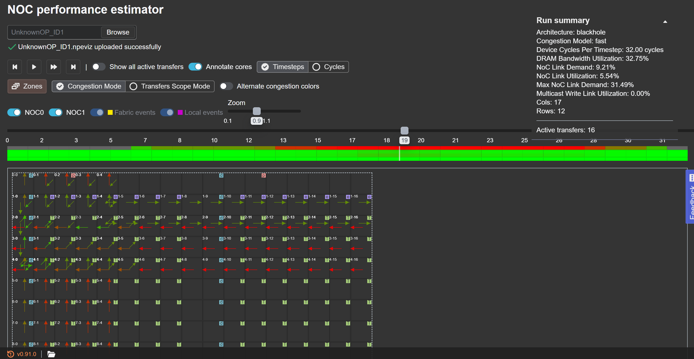

# **tt-npe NoC Performance Estimator**

- **tt-npe** is Tenstorrent's **NoC (Network-on-Chip) profiler/simulator**.
- Consumes **raw noc traces** collected by tt-metal's kernel profiler and reports **per-op DRAM / NoC / Ethernet bandwidth utilization** and **congestion impact**.
- Also runs a **standalone simulation mode** driven by a workload JSON — useful for what-if analysis without re-running on hardware.
- Produces **ttnn-visualizer timeline JSONs** for graphical inspection of NoC events.

## Two Modes

### Profiler Mode
- Feed real noc traces (from `--collect-noc-traces` on tt-metal) → tt-npe simulates NoC behavior over those traces
- Output: per-op stats (NoC Util %, DRAM BW Util %, Cong Impact %, Cycle %), merged trace JSONs, timeline files
- **This is the mode used for measuring real workloads (e.g., ResNet50 baseline)**

### Simulation Mode
- Feed a hand-written workload JSON (list of NoC transfers with src/dst coord, byte count, timing) → tt-npe simulates end-to-end
- Output: overall stats + timeline
- Useful for **what-if analysis** (e.g., "what if this reshard is removed?", "what if the sharding grid is 5x4 instead of 4x4?")

<br>

## Important Caveat — Device Model is Blackhole Reference

- tt-npe ships with **Blackhole** and **Wormhole B0** device models only.
- The Blackhole device model uses:
  - `arch-blackhole.yaml`: **17x12 grid**, **24 DRAM cores** in 8 groups of 3
  - `blackhole.hpp`: **LinkBandwidth = 60.9 B/cycle**, `DRAMBandwidthPerChip = NUM_DRAM_CONTROLLERS × per_controller_BW`
- **Eagle-N is Blackhole-derived (same Tensix IP) but has a smaller physical grid (6x4)**.
- What is **real Eagle-N**:
  - op cycle counts, byte counts, NoC event coords and timing (from Eagle-N kernel profiler)
- What is **Blackhole assumption**:
  - peak DRAM BW (denominator of `DRAM BW Util %`)
  - peak Link BW (denominator of `NoC Util %`)
  - grid size and routing topology (used in congestion simulation)
- **Implication**: relative op ranking is valid; absolute BW numbers should be caveated as "Blackhole reference peak" until an Eagle-N device model is added to tt-npe.

<br>

## Installation on bos_host Container

See `tt-npe/tt-npe_install.md` for the full step-by-step. Summary:

1. **clone tt-npe under `/`** (self-contained; nothing touches system paths)
2. **install `uv`** (Python package manager) with the standalone installer
3. **activate tt-metal env first** (`cd /tt-metal && source env_set.sh`) — reversing this order breaks the venv
4. **build tt-npe** (`cd /tt-npe && ./build-npe.sh`) — 5~15 min
5. **source tt-npe env** (`source /tt-npe/ENV_SETUP`)

Removal is `rm -rf /tt-npe` + `rm -rf ~/.local/bin/uv`.

<br>

## Session Startup Commands

Every time you re-enter the container:

```bash
$ export PATH="$HOME/.local/bin:$PATH"
$ cd /tt-metal && source env_set.sh
$ source /tt-npe/ENV_SETUP

# sanity check
$ which tt_npe.py                    # /tt-npe/install/bin/tt_npe.py
$ which npe_analyze_noc_trace_dir.py
$ python -c "import ttnn; print('OK')"
```

Shortcut alias:

```bash
$ echo 'alias npeenv="cd /tt-metal && source env_set.sh && cd - && source /tt-npe/ENV_SETUP"' >> ~/.bashrc
```

<br>

## Profiling Workflow (1) — Collect NoC Traces

Use tt-metal's `profile_this.py` with `--collect-noc-traces`. Run a **single forward** with `iterations=1` and the smallest batch you can — the device DRAM buffer for NoC events fills quickly.

```bash
$ cd /tt-metal
$ TT_METAL_PROFILER_PROGRAM_SUPPORT_COUNT=10000 \
    tools/tracy/profile_this.py \
    --collect-noc-traces \
    -c 'pytest models/bos_model/resnet50/tests/test_ttnn_functional_resnet50.py -k batch_1'
```

### Environment variable notes

- `TT_METAL_PROFILER_PROGRAM_SUPPORT_COUNT=10000` — required by tt-npe; grants enough on-device program slots for a small op graph
- Use a **test that runs a single forward** (e.g., `test_ttnn_functional_resnet50.py`), **not** an FPS-measurement script (`run_resnet50.py`) — FPS scripts loop many iterations and blow the buffer instantly

### Output locations

- **Raw noc trace JSONs**: `generated/profiler/.logs/*.json`
- **ttnn-visualizer timelines**: `generated/profiler/reports/<timestamp>/npe_viz/*.json`
- **Ops perf report CSV** (with NoC/DRAM/ETH utilization columns): `generated/profiler/reports/<timestamp>/ops_perf_report_*.csv`

<br>

## Profiling Workflow (2) — Op Count Ceiling

- The kernel profiler event buffer per core is **fixed-size DRAM**. Each NoC event emits a marker; when the region fills, later markers are **silently dropped**.
- Docs state the ceiling is **approximately 5-100 ops**. In practice, ResNet50 batch_1 (123 ops) already exceeds it — only the first ~68 ops survive.
- **Symptom**: Tracy stitching fails with `AssertionError: Expected N but received M ops`. The `ops_perf_report_*.csv` is **not generated**.

### Workarounds

1. **Reduce iterations** to 1. Already the default for the recommended test.
2. **Reduce batch size** to the smallest that still exercises the ops of interest.
3. **Split the model into subgraphs** and profile each separately (see subgraph splitting section below).
4. Use `npe_analyze_noc_trace_dir.py` on the surviving raw JSONs — even without CSV, per-op stats can still be printed and timelines still generated.

<br>

## Profiling Workflow (3) — Analyze Raw Traces

Even when Tracy stitching failed, the raw noc JSONs in `.logs/` are usable directly:

```bash
$ npe_analyze_noc_trace_dir.py /tt-metal/generated/profiler/.logs/ -e -m 200 \
    > /tt-npe/npe_summary.txt 2>&1
```

- `-e` — emit visualizer timelines under `generated/profiler/npe_viz/`
- `-m 200` — print top 200 rows of the summary table (default 40)

### Output rows

Each row is one op; key columns:

- **NoC Util (%)**: fraction of available NoC bandwidth used during the op
- **DRAM BW Util (%)**: fraction of available DRAM bandwidth used
- **Cong Impact (%)**: cycles wasted due to link congestion
- **% of Overall Cycles**: op's share of total wall time

Overall summary at the bottom:

- **cycle-weighted DRAM BW util** — headline number for compute-bound vs memory-bound
- **cycle-weighted ETH BW util**

<br>

## Profiling Workflow (4) — Op Name Join

The raw noc trace does **not** carry ttnn op names — every row appears as `UnknownOP`. To recover names:

1. Open `generated/profiler/reports/<timestamp>/tracy_ops_data.csv` (if Tracy stitching succeeded) or the per-op `.tracy` metadata
2. Join with the tt-npe stats on `op_id`
3. Emit a final CSV with columns like `op_id, op_name, layer, dram_bw_util, noc_util, cong_impact, cycles_pct`

A ~30-line Python script with pandas handles this.

<br>

## Profiling Workflow (5) — Subgraph Splitting

When the op count exceeds ~65, profile the model in stages. Because the profiler samples in execution order, only the **first** ~65 ops survive on any given run — later ones are dropped.

### Strategy: fake tensor injection

Insert a `RESNET_STAGE` env-var gate in the model's `__call__` and run the model multiple times, each covering a disjoint sub-range. For runs that start midway through the network, synthesize a **random input tensor** with the correct shape, dtype, and sharded memory config at the entry point of that sub-range.

This works because tt-npe measures **NoC/DRAM traffic patterns** — these depend on tensor **shape and layout**, not on tensor values. PCC validation should be skipped for partial runs.

Example split for ResNet50:

| Stage | Range | Approx op count |
|---|---|---|
| A | stem + layer1 + layer2 (early return) | ~55 |
| B | layer3 only (fake input at layer2 output shape) | ~48 |
| C | layer4 + head (fake input at layer3 output shape) | ~35 |

Run each stage with a different env value, move the `.logs/` directory between runs, then analyze each stage independently.

<br>

## Visualizing NPE Timelines

- Web app (no install): https://ttnn-visualizer.tenstorrent.com/npe
- Local install: https://github.com/tenstorrent/ttnn-visualizer/
- Load any `*.json` from `generated/profiler/npe_viz/`

The visualizer shows each NoC link's utilization over time, highlighting congestion hotspots.

<br>

## Known Upstream Bugs and Patches

Applied on the current bos_host tt-npe install (see `tt-npe/tt-npe_install.md` for exact `sed` commands):

- **`wallclock_runtime_us` AttributeError** — CLI references pre-refactor multi-device Stats API. Patched by removing the print string.
- **`src_device_id` KeyError** in `fabric_post_process.py:594` — mesh-only field referenced on single-chip traces. Patched with `x.get("src_device_id", 0)`.
- **Multicast coord assertion** (unresolved) — some ops fail with `MulticastCoordSet: start coord must be to the top-left of end coord`. Suspected mismatch of multicast coord ordering assumption on Blackhole single-chip. Impact: ~10% of ops (reshard/halo-suspected) drop out on ResNet50 batch_1. Remaining ops still produce useful stats.

<br>

## Simulation Mode Quick Check

Verify the install with a bundled example workload:

```bash
$ tt_npe.py -w /tt-npe/tt_npe/workload/example_wl.json
```

Should print a stats summary without crashing.

<br>

## Additional Resources

[tt-npe Repository](https://github.com/tenstorrent/tt-npe)

[tt-npe Getting Started (upstream)](https://github.com/tenstorrent/tt-npe/blob/main/docs/src/getting_started.md)

[NoC Trace Format Spec](https://github.com/tenstorrent/tt-npe/blob/main/tt_npe/doc/noc_trace_format.md)

[ttnn Visualizer Web App](https://ttnn-visualizer.tenstorrent.com/npe)

[Blackhole Device Layout](https://github.com/tenstorrent/tt-npe/blob/main/tt_npe/data/device/layout/arch-blackhole.yaml)

[tt-npe install notes (this repo)](../../tt-npe/tt-npe_install.md)

[Tracy Intro (companion tutorial)](Tracy_intro.md)
